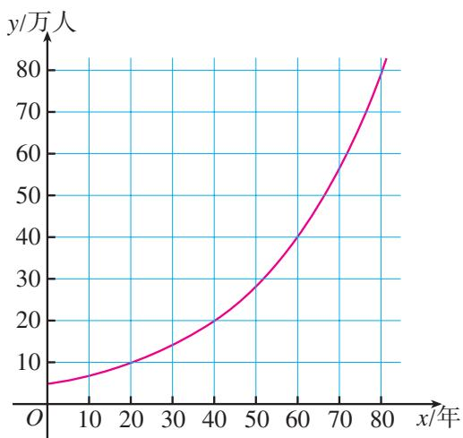

# 例 4 利用指数函数图象估计城市人口倍增期·解析

对应题目：[例 4 利用指数函数图象估计城市人口倍增期](../Q4266535523382440260.md)

分析：（1）因为该城市人口呈指数增长，而同一指数函数的倍增期是相同的，所以可以从图象中选取适当的点计算倍增期.

（2）要计算20年后的人口数，关键是要找到20年与倍增期的数量关系.

解：（1）观察图 4.2-7，发现该城市人口经过20年约为10万人，经过40年约为20万人，即由10万人口增加到20万人口所用的时间约为20年，所以该城市人口每翻一番所需的时间约为20年.

（2）因为倍增期为 20 年，所以每经过 20 年，人口将翻一番。因此，从 80 万人开始，经过 20 年，该城市人口大约会增长到 160 万人。

  
图4.2-7

## 所属组织

- [4.2.2 指数函数的图象和性质](../../%E9%A2%98%E5%9E%8B/%E4%BA%BA%E6%95%99A-%E5%BF%85%E4%BF%AE%E7%AC%AC%E4%B8%80%E5%86%8C/%E7%AC%AC%E5%9B%9B%E7%AB%A0%20%E6%8C%87%E6%95%B0%E5%87%BD%E6%95%B0%E4%B8%8E%E5%AF%B9%E6%95%B0%E5%87%BD%E6%95%B0/4.2%20%E6%8C%87%E6%95%B0%E5%87%BD%E6%95%B0/4.2.2%20%E6%8C%87%E6%95%B0%E5%87%BD%E6%95%B0%E7%9A%84%E5%9B%BE%E8%B1%A1%E5%92%8C%E6%80%A7%E8%B4%A8.md)
