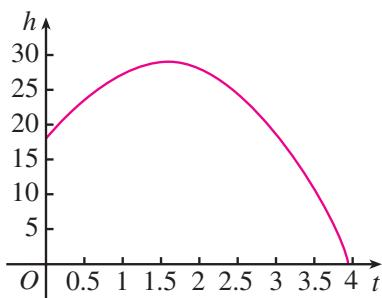

# 例 4 求烟花高度二次函数的最大值·解析

对应题目：[例 4 求烟花高度二次函数的最大值](../Q4451360221261989007.md)

解：画出函数 $h(t)=-4.9t^{2}+14.7t+18$ 的图象（图 3.2-4）. 显然，函数图象的顶点就是烟花上升的最高点，顶点的横坐标就是烟花爆竹裂的最佳时刻，纵坐标就是这时距地面的高度.

  
图3.2-4

烟花设计者就是按照这些数据设定引火线的长度，以达到施放烟花的最佳效果.

由二次函数的知识，对于函数 $h(t) = -4.9t^2 + 14.7t + 18$ ，我们有：

当 $t = -\frac{14.7}{2 \times (-4.9)} = 1.5$ 时，函数有最大值

$$
h = \frac {4 \times (- 4 . 9) \times 1 8 - 1 4 . 7 ^ {2}}{4 \times (- 4 . 9)} \approx 2 9.
$$

于是，烟花冲出后 1.5 s 是它爆裂的最佳时刻，这时距地面的高度约为 29 m.

## 所属组织

- [函数的最大（小）值](../../%E9%A2%98%E5%9E%8B/%E4%BA%BA%E6%95%99A-%E5%BF%85%E4%BF%AE%E7%AC%AC%E4%B8%80%E5%86%8C/%E7%AC%AC%E4%B8%89%E7%AB%A0%20%E5%87%BD%E6%95%B0%E7%9A%84%E6%A6%82%E5%BF%B5%E4%B8%8E%E6%80%A7%E8%B4%A8/3.2%20%E5%87%BD%E6%95%B0%E7%9A%84%E5%9F%BA%E6%9C%AC%E6%80%A7%E8%B4%A8/3.2.1%20%E5%8D%95%E8%B0%83%E6%80%A7%E4%B8%8E%E6%9C%80%E5%A4%A7%28%E5%B0%8F%29%E5%80%BC/%E5%87%BD%E6%95%B0%E7%9A%84%E6%9C%80%E5%A4%A7%28%E5%B0%8F%29%E5%80%BC.md)
