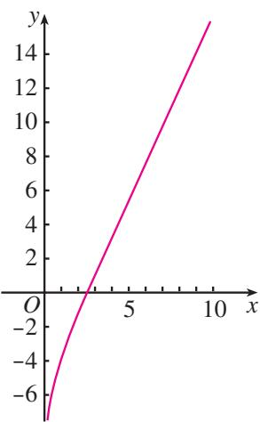

# 例 1 求方程 $\ln x + 2x·解析

对应题目：[例 1 求方程 $\ln x + 2x](../Q5612506304977722741.md)

分析：可以先借助计算工具画出函数 $y = \ln x + 2x - 6$ 的图象或列出 $x, y$ 的对应值表，为观察、判断零点所在区间提供帮助.

解：设函数 $f(x) = \ln x + 2x - 6$ ，利用计算工具，列出函数 $y = f(x)$ 的对应值表（表4.5-1），并画出图象（图4.5-2）.

表4.5-1

<table><tr><td>x</td><td>y</td></tr><tr><td>1</td><td>-4</td></tr><tr><td>2</td><td>-1.3069</td></tr><tr><td>3</td><td>1.0986</td></tr><tr><td>4</td><td>3.3863</td></tr><tr><td>5</td><td>5.6094</td></tr><tr><td>6</td><td>7.7918</td></tr><tr><td>7</td><td>9.9459</td></tr><tr><td>8</td><td>12.0794</td></tr><tr><td>9</td><td>14.1972</td></tr></table>

  
图4.5-2

由表 4.5-1 和图 4.5-2 可知， $f(2)<0,\ f(3)>0$ ，则 $f(2)f(3)<0$ 。由函数零点存在定理可知，函数 $f(x)=\ln x+2x-6$ 在区间 $(2,3)$ 内至少有一个零点。

容易证明，函数 $f(x) = \ln x + 2x - 6, x \in (0, +\infty)$ 是增函数，所以它只有一个零点，即相应方程 $\ln x + 2x - 6 = 0$ 只有一个实数解.

为什么由图4.5-2和 $f(2)f(3) < 0$ 还不能说明函数 $f(x)$ 只有一个零点？你能证明函数 $y = f(x)$ 是增函数吗？

## 所属组织

- [4.5.1 函数的零点与方程的解](../../%E9%A2%98%E5%9E%8B/%E4%BA%BA%E6%95%99A-%E5%BF%85%E4%BF%AE%E7%AC%AC%E4%B8%80%E5%86%8C/%E7%AC%AC%E5%9B%9B%E7%AB%A0%20%E6%8C%87%E6%95%B0%E5%87%BD%E6%95%B0%E4%B8%8E%E5%AF%B9%E6%95%B0%E5%87%BD%E6%95%B0/4.5%20%E5%87%BD%E6%95%B0%E7%9A%84%E5%BA%94%E7%94%A8%EF%BC%88%E4%BA%8C%EF%BC%89/4.5.1%20%E5%87%BD%E6%95%B0%E7%9A%84%E9%9B%B6%E7%82%B9%E4%B8%8E%E6%96%B9%E7%A8%8B%E7%9A%84%E8%A7%A3.md)
