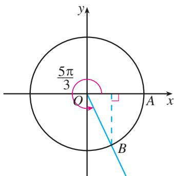

# 例 1 利用单位圆定义求 5π/3 的正弦、余弦和正切值·解析

对应题目：[例 1 利用单位圆定义求 5π/3 的正弦、余弦和正切值](../Q5730716899165875714.md)

解：在直角坐标系中，作 $\angle AOB = \frac{5\pi}{3}$ （图5.2-3). 易知 $\angle AOB$ 的终边与单位圆的交点坐标为 $\left(\frac{1}{2}, -\frac{\sqrt{3}}{2}\right)$ . 所以，

$$
\sin \frac {5 \pi}{3} = - \frac {\sqrt {3}}{2},
$$

  
图5.2-3

$$
\cos \frac {5 \pi}{3} = \frac {1}{2},
$$

$$
\tan {\frac {5 \pi}{3}} = - \sqrt {3}.
$$

## 所属组织

- [5.2.1 三角函数的概念](../../%E9%A2%98%E5%9E%8B/%E4%BA%BA%E6%95%99A-%E5%BF%85%E4%BF%AE%E7%AC%AC%E4%B8%80%E5%86%8C/%E7%AC%AC%E4%BA%94%E7%AB%A0%20%E4%B8%89%E8%A7%92%E5%87%BD%E6%95%B0/5.2%20%E4%B8%89%E8%A7%92%E5%87%BD%E6%95%B0%E7%9A%84%E6%A6%82%E5%BF%B5/5.2.1%20%E4%B8%89%E8%A7%92%E5%87%BD%E6%95%B0%E7%9A%84%E6%A6%82%E5%BF%B5.md)
