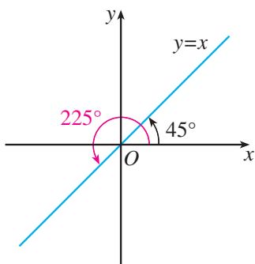

# 例 3 写出终边在直线y=x上的角的集合并求指定范围内的角·解析

对应题目：[例 3 写出终边在直线y=x上的角的集合并求指定范围内的角](../Q8243792145997455912.md)

解：如图 5.1-8，在直角坐标系中画出直线 y=x，可以发现它与 x 轴的夹角是 $45^{\circ}$ ，在 $0^{\circ} \sim 360^{\circ}$ 范围内，终边在直线 y=x 上的角有两个： $45^{\circ}$ ， $225^{\circ}$ 。因此，终边在直线 y=x 上的角的集合

$$
\begin{array}{r l} S & = \{\beta | \beta = 4 5 ^ {\circ} + k \cdot 3 6 0 ^ {\circ}, k \in \mathbf {Z} \} \cup \\ & \{\beta | \beta = 2 2 5 ^ {\circ} + k \cdot 3 6 0 ^ {\circ}, k \in \mathbf {Z} \} \\ & = \{\beta | \beta = 4 5 ^ {\circ} + n \cdot 1 8 0 ^ {\circ}, n \in \mathbf {Z} \}. \end{array}
$$

  
图5.1-8

$S$ 中适合不等式 $-360^{\circ} \leqslant \beta < 720^{\circ}$ 的元素 $\beta$ 有

$$
\begin{array}{l} 4 5 ^ {\circ} - 2 \times 1 8 0 ^ {\circ} = - 3 1 5 ^ {\circ}, \\ 4 5 ^ {\circ} - 1 \times 1 8 0 ^ {\circ} = - 1 3 5 ^ {\circ}, \\ 4 5 ^ {\circ} + 0 \times 1 8 0 ^ {\circ} = 4 5 ^ {\circ}, \\ 4 5 ^ {\circ} + 1 \times 1 8 0 ^ {\circ} = 2 2 5 ^ {\circ}, \\ 4 5 ^ {\circ} + 2 \times 1 8 0 ^ {\circ} = 4 0 5 ^ {\circ}, \\ 4 5 ^ {\circ} + 3 \times 1 8 0 ^ {\circ} = 5 8 5 ^ {\circ}. \end{array}
$$

## 所属组织

- [5.1.1 任意角](../../%E9%A2%98%E5%9E%8B/%E4%BA%BA%E6%95%99A-%E5%BF%85%E4%BF%AE%E7%AC%AC%E4%B8%80%E5%86%8C/%E7%AC%AC%E4%BA%94%E7%AB%A0%20%E4%B8%89%E8%A7%92%E5%87%BD%E6%95%B0/5.1%20%E4%BB%BB%E6%84%8F%E8%A7%92%E5%92%8C%E5%BC%A7%E5%BA%A6%E5%88%B6/5.1.1%20%E4%BB%BB%E6%84%8F%E8%A7%92.md)
