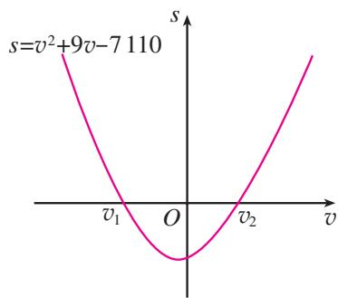

# 例 5 利用一元二次不等式解决汽车刹车距离与车速估算问题·解析

对应题目：[例 5 利用一元二次不等式解决汽车刹车距离与车速估算问题](../Q8703660402751640112.md)

解：根据题意，得

$$
\frac {1}{2 0} v + \frac {1}{1 8 0} v ^ {2} > 3 9. 5.
$$

移项整理，得

刹车距离是指汽车刹车后由于惯性往前滑行的距离.

$$
v ^ {2} + 9 v - 7 1 1 0 > 0.
$$

对于方程 $v^{2}+9v-7\ 110=0,\ \Delta>0$ ，方程有两个实数根

$$
v _ {1} = \frac {- 9 - \sqrt {2 8 5 2 1}}{2}, v _ {2} = \frac {- 9 + \sqrt {2 8 5 2 1}}{2}.
$$

画出二次函数 $s = v^{2} + 9v - 7110$ 的图象（图 2.3-7），结合图象得不等式的解集为 $\{v \mid v < v_{1}, \text{或 } v > v_{2}\}$ ，从而原不等式的解集为

  
图2.3-7

$$
\{v \mid v <   v _ {1}  ,   \text {或}   v > v _ {2} \}.
$$

因为车速 $v > 0$ ，所以 $v > v_{2}$ 而 $79.9 < v_{2} < 80$ ，所以这辆汽车刹车前的车速至少为 $80~\mathrm{km / h}$

类似地，第2.1节的不等式①经移项整理，得 $2x^{2}-13x+20\leqslant0$ 。用上述方法解这个不等式，得 $\{x\mid2.5\leqslant x\leqslant4\}$ 。所以，当每本杂志的定价不低于2.5元且不超过4元时，提价后的销售总收入不低于20万元。

## 所属组织

- [2.3 二次函数与一元二次方程、不等式](../../%E9%A2%98%E5%9E%8B/%E4%BA%BA%E6%95%99A-%E5%BF%85%E4%BF%AE%E7%AC%AC%E4%B8%80%E5%86%8C/%E7%AC%AC%E4%BA%8C%E7%AB%A0%20%E4%B8%80%E5%85%83%E4%BA%8C%E6%AC%A1%E5%87%BD%E6%95%B0%E3%80%81%E6%96%B9%E7%A8%8B%E5%92%8C%E4%B8%8D%E7%AD%89%E5%BC%8F/2.3%20%E4%BA%8C%E6%AC%A1%E5%87%BD%E6%95%B0%E4%B8%8E%E4%B8%80%E5%85%83%E4%BA%8C%E6%AC%A1%E6%96%B9%E7%A8%8B%E3%80%81%E4%B8%8D%E7%AD%89%E5%BC%8F/2.3%20%E4%BA%8C%E6%AC%A1%E5%87%BD%E6%95%B0%E4%B8%8E%E4%B8%80%E5%85%83%E4%BA%8C%E6%AC%A1%E6%96%B9%E7%A8%8B%E3%80%81%E4%B8%8D%E7%AD%89%E5%BC%8F.md)
