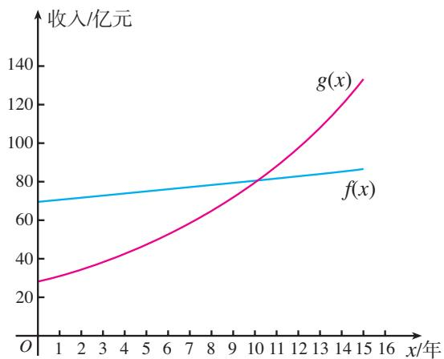

# 例 2 指数增长与指数衰减模型的实际应用·解析

对应题目：[例 2 指数增长与指数衰减模型的实际应用](../Q9479688121534472470.md)

解：（1）设经过 $x$ 年，游客给A，B两地带来的收入分别为 $f(x)$ 和 $g(x)$ ，则

$$
f (x) = 1 1 5 0 \times (1 0 x + 6 0 0),
$$

$$
g (x) = 1 0 0 0 \times 2 7 8 \times 1. 1 1 ^ {x}.
$$

利用计算工具可得，

当 x=0 时， $f(0)-g(0)=412\ 000.$

当 $x \approx 10.22$ 时， $f(10.22) \approx g(10.22)$ .

结合图4.2-3可知：

当 $x < 10.22$ 时， $f(x) > g(x)$ ，

当 $x > 10.22$ 时， $f(x) < g(x)$ .

当 $x = 14$ 时， $g(14) - f(14) \approx 347303$ .

图4.2-3

这说明，在2001年，游客给A地带来的收入比B

地多 412 000 万元；随后 10 年，虽然 $f(x) > g(x)$ ，但 $g(x)$ 的增长速度大于 $f(x)$ ；根据上述数据，并考虑到实际情况，在 2011 年 3 月某个时刻就有 $f(x) = g(x)$ ，这时游客给 A 地带来的收入和 B 地差不多；此后， $f(x) < g(x)$ ，游客给 B 地带来的收入超过了 A 地；由于 $g(x)$ 增长得越来越快，在 2015 年，B 地的收入已经比 A 地多 347 303 万元了。

(2) 设生物死亡 $x$ 年后，它体内碳 14 含量为 $h(x)$ .

如果把刚死亡的生物体内碳 14 含量看成 1 个单位，那么

$$
h (x) = \left(\left(\frac {1}{2}\right) ^ {\frac {1}{5 7 3 0}}\right) ^ {x}.
$$

当 $x = 10000$ 时，利用计算工具求得 $h(10000) = \left(\frac{1}{2}\right)^{\frac{10000}{5730}}\approx 0.30.$

所以，生物死亡 10 000 年后，它体内碳 14 含量衰减为原来的约 30%.

在实际问题中，经常会遇到类似于例2(1)的指数增长模型：设原有量为 $N$ ，每次的增长率为 $p$ ，经过 $x$ 次增长，该量增长到 $y$ ，则 $y = N(1 + p)^x (x \in \mathbf{N})$ 。形如 $y = ka^x (k \in \mathbf{R}$ 且 $k \neq 0; a > 0$ ，且 $a \neq 1$ ）的函数是刻画指数增长或指数衰减变化规律的非常有用的函数模型。

114 第四章 指数函数与对数函数

## 所属组织

- [4.2.1 指数函数的概念](../../%E9%A2%98%E5%9E%8B/%E4%BA%BA%E6%95%99A-%E5%BF%85%E4%BF%AE%E7%AC%AC%E4%B8%80%E5%86%8C/%E7%AC%AC%E5%9B%9B%E7%AB%A0%20%E6%8C%87%E6%95%B0%E5%87%BD%E6%95%B0%E4%B8%8E%E5%AF%B9%E6%95%B0%E5%87%BD%E6%95%B0/4.2%20%E6%8C%87%E6%95%B0%E5%87%BD%E6%95%B0/4.2.1%20%E6%8C%87%E6%95%B0%E5%87%BD%E6%95%B0%E7%9A%84%E6%A6%82%E5%BF%B5.md)
