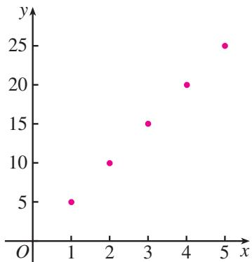

# 例 4 某种笔记本的单价是 5 元·解析

对应题目：[例 4 某种笔记本的单价是 5 元](../Q9980076590973766234.md)

解：这个函数的定义域是数集 $\{1,2,3,4,5\}$ .

用解析法可将函数 $y = f(x)$ 表示为

$$
y = 5 x, x \in \{1, 2, 3, 4, 5 \}.
$$

用列表法可将函数 $y = f(x)$ 表示为

<table><tr><td>笔记本数x</td><td>1</td><td>2</td><td>3</td><td>4</td><td>5</td></tr><tr><td>钱数y</td><td>5</td><td>10</td><td>15</td><td>20</td><td>25</td></tr></table>

用图象法可将函数 $y=f(x)$ 表示为图 3.1-2.

  
图3.1-2

?

函数图象既可以是光滑的曲线，也可以是直线、折线、离散的点等。那么判断一个图形是不是函数图象的依据是什么？

## 所属组织

- [3.1.2 函数的表示法](../../%E9%A2%98%E5%9E%8B/%E4%BA%BA%E6%95%99A-%E5%BF%85%E4%BF%AE%E7%AC%AC%E4%B8%80%E5%86%8C/%E7%AC%AC%E4%B8%89%E7%AB%A0%20%E5%87%BD%E6%95%B0%E7%9A%84%E6%A6%82%E5%BF%B5%E4%B8%8E%E6%80%A7%E8%B4%A8/3.1%20%E5%87%BD%E6%95%B0%E7%9A%84%E6%A6%82%E5%BF%B5%E5%8F%8A%E5%85%B6%E8%A1%A8%E7%A4%BA/3.1.2%20%E5%87%BD%E6%95%B0%E7%9A%84%E8%A1%A8%E7%A4%BA%E6%B3%95.md)
