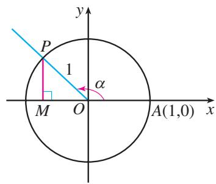

$$
\boxed {\sin^ {2} \alpha + \cos^ {2} \alpha = 1.}
$$

显然，当 $\alpha$ 的终边与坐标轴重合时，这个公式也成立.

根据三角函数的定义，当 $\alpha \neq k\pi +\frac{\pi}{2} (k\in \mathbf{Z})$ 时，有

$$
\frac {\sin \alpha}{\cos \alpha} = \tan \alpha .
$$

  
图5.2-7

这就是说，同一个角 $\alpha$ 的正弦、余弦的平方和等于1，

商等于角 $\alpha$ 的正切.
