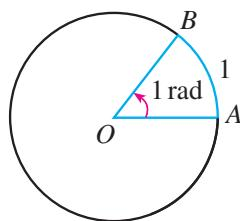

在半径为 $r$ 的圆中，弧长为 $l$ 的弧所对的圆心角为 $\alpha\ \mathrm{rad}$ ，那么

  
图5.1-11

$$
|\alpha| = \frac{l}{r}.
$$

其中， $\alpha$ 的正负由角 $\alpha$ 的终边的旋转方向决定，即逆时针旋转为正，顺时针旋转为负。一般地，正角的弧度数是一个正数，负角的弧度数是一个负数，零角的弧度数是 $0$ 。
