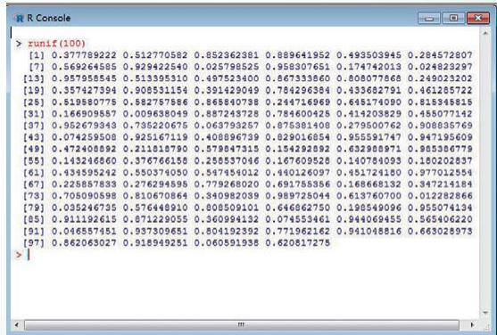

1. 用 runif（）函数产生区间 $[0, 1]$ 内的随机数

例如，要产生 100 个区间 [0, 1] 内的随机数，在命令窗口中输入 “runif (100)” 即可（图 1）.

2. 用 sample（）函数产生区间 $[a, b]$ 内的整数随机数

例如，在命令窗口中输入“sample (1: 712, 100, T)”，就产生了100个区间[1, 712]内的可重复的整数随机数。如果希望随机数不可重复，只要把sample函数中的参数T改为F即可。

  
图1
