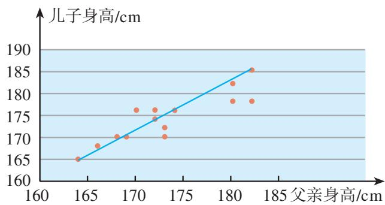
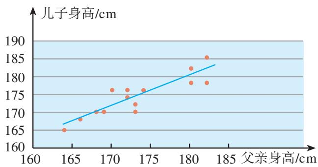
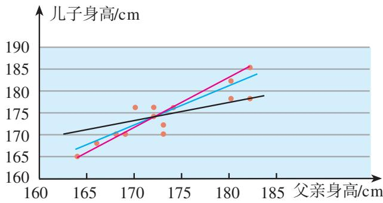
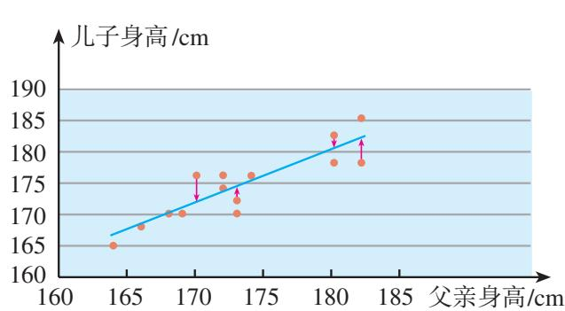
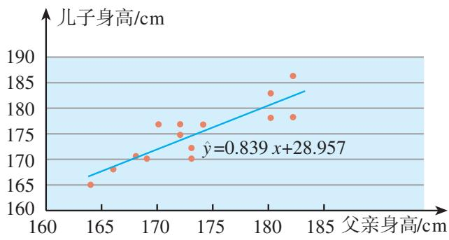

# 一元线性回归参数的最小二乘估计

## 高中选择性必修 第三册·人教A版数学

在一元线性回归模型中，表达式 $Y = bx + a + e$ 刻画的是变量 $Y$ 与变量 $x$ 之间的线性相关关系，其中参数 $a$ 和 $b$ 未知，需要根据成对样本数据进行估计。由模型的建立过程可知，参数 $a$ 和 $b$ 刻画了变量 $Y$ 与变量 $x$ 的线性关系，因此通过成对样本数据估计这两个参数，相当于寻找一条适当的直线，使表示成对样本数据的这些散点在整体上与这条直线最接近。

探究

利用散点图8.2-1找出一条直线，使各散点在整体上与此直线尽可能接近.

有的同学可能会想，可以采用测量的方法，先画出一条直线，测量出各点与它的距离，然后移动直线，到达一个使距离的和最小的位置。测量出此时的斜率和截距，就可得到一条直线，如图8.2-2所示。

  
图8.2-2

  
图8.2-3

有的同学可能会想，可以在图中选择这样的两点画直线，使得直线两侧的点的个数基本相同，把这条直线作为所求直线，如图8.2-3所示.

还有的同学会想，在散点图中多取几对点，确定出几条直线的方程，再分别求出这些直线的斜率、截距的平均数，将这两个平均数作为所求直线的斜率和截距如图8.2-4所示.

  
图8.2-4

同学们不妨去实践一下，看看这些方法是不是真的可行.

上面这些方法虽然有一定的道理，但比较难操作，我们需要另辟蹊径.

先进一步明确我们面临的任务：从成对样本数据出发，用数学的方法刻画“从整体上看，各散点与直线最接近”.

通常，我们会想到利用点到直线 $y=bx+a$ 的“距离”来刻画散点与该直线的接近程度，然后用所有“距离”之和刻画所有样本观测数据与该直线的接近程度。我们设满足一元线性回归模型的两个变量的 n 对样本数据为 $(x_{1}, y_{1}), (x_{2}, y_{2}), \cdots, (x_{n}, y_{n})$ ,

由 $y_{i}=bx_{i}+a+e_{i}(i=1,2,\cdots,n)$ ，得 $\left|y_{i}-(bx_{i}+a)\right|=\left|e_{i}\right|$ 。显然 $\left|e_{i}\right|$ 越小，表示点 $(x_{i},y_{i})$ 与点 $(x_{i},bx_{i}+a)$ 的“距离”越小，即样本数据点离直线 $y=bx+a$ 的竖直距离越小，如图 8.2-5 所示。特别地，当 $e_{i}=0$ 时，表示点 $(x_{i},y_{i})$ 在这条直线上。
因此，可以用这 n 个竖直距离之和

  
图8.2-5

$$
\sum_ {i = 1} ^ {n} \left| y _ {i} - (b x _ {i} + a) \right|
$$

来刻画各样本观测数据与直线 $y=bx+a$ 的 “整体接近程度”.

在实际应用中，因为绝对值使得计算不方便，所以人们通常用各散点到直线的竖直距离的平方之和

$$
Q = \sum_ {i = 1} ^ {n} (y _ {i} - b x _ {i} - a) ^ {2}
$$

来刻画“整体接近程度”.

在上式中， $x_{i}$ ， $y_{i}(i=1,2,3,\cdots,n)$ 是已知的成对样本数据，所以Q由a和b所决定，即它是a和b的函数。因为Q还可以表示为 $\sum_{i=1}^{n}e_{i}^{2}$ ，即它是随机误差的平方和，这个和当然越小越好，所以我们取使Q达到最小的a和b的值，作为截距和斜率的估计值。

下面利用成对样本数据求使 Q 取最小值的 a, b.

记 $\overline{x} = \frac{1}{n}\sum_{i = 1}^{n}x_{i},\overline{y} = \frac{1}{n}\sum_{i = 1}^{n}y_{i}$ 因为

$$
\begin{array}{r l} Q (a, b) & = \sum_ {i = 1} ^ {n} (y _ {i} - b x _ {i} - a) ^ {2} \\ & = \sum_ {i = 1} ^ {n} [ y _ {i} - b x _ {i} - (\overline {{y}} - b \overline {{x}}) + (\overline {{y}} - b \overline {{x}}) - a ] ^ {2} \\ & = \sum_ {i = 1} ^ {n} [ (y _ {i} - \overline {{y}}) - b (x _ {i} - \overline {{x}}) + (\overline {{y}} - b \overline {{x}}) - a ] ^ {2} \\ & = \sum_ {i = 1} ^ {n} [ (y _ {i} - \overline {{y}}) - b (x _ {i} - \overline {{x}}) ] ^ {2} + 2 \sum_ {i = 1} ^ {n} [ (y _ {i} - \overline {{y}}) - b (x _ {i} - \overline {{x}}) ] \times \\ & [ (\overline {{y}} - b \overline {{x}}) - a ] + n [ (\overline {{y}} - b \overline {{x}}) - a ] ^ {2}, \end{array}
$$

注意到

$$
\begin{array}{l} \sum_ {i = 1} ^ {n} \left[ (y _ {i} - \overline {{y}}) - b (x _ {i} - \overline {{x}}) \right] (\overline {{y}} - b \overline {{x}} - a) \\ = (\overline {{y}} - b \overline {{x}} - a) \sum_ {i = 1} ^ {n} \left[ (y _ {i} - \overline {{y}}) - b (x _ {i} - \overline {{x}}) \right] \\ = (\overline {{y}} - b \overline {{x}} - a) \left[ \sum_ {i = 1} ^ {n} (y _ {i} - \overline {{y}}) - b \sum_ {i = 1} ^ {n} (x _ {i} - \overline {{x}}) \right] \\ = (\overline {{y}} - b \overline {{x}} - a) \left[ (n \overline {{y}} - n \overline {{y}}) - b (n \overline {{x}} - n \overline {{x}}) \right] \\ = 0, \end{array}
$$

所以

$$
Q (a, b) = \sum_ {i = 1} ^ {n} \left[ \left(y _ {i} - \bar {y}\right) - b \left(x _ {i} - \bar {x}\right) \right] ^ {2} + n (\bar {y} - b \bar {x} - a) ^ {2}.
$$

上式右边各项均为非负数，且前 $n$ 项与 $a$ 无关．所以，要使 $Q$ 取到最小值， $n(\overline{y} - b\overline{x} - a)^2$ 的值应为0，即 $a = \overline{y} - b\overline{x}$ ．此时

$$
\begin{array}{r l} Q (a, b) & = \sum_ {i = 1} ^ {n} \left[ (y _ {i} - \overline {{y}}) - b (x _ {i} - \overline {{x}}) \right] ^ {2} \\ & = b ^ {2} \sum_ {i = 1} ^ {n} (x _ {i} - \overline {{x}}) ^ {2} - 2 b \sum_ {i = 1} ^ {n} (x _ {i} - \overline {{x}}) (y _ {i} - \overline {{y}}) + \sum_ {i = 1} ^ {n} (y _ {i} - \overline {{y}}) ^ {2}. \end{array}
$$

上式是关于 $b$ 的二次函数，因此要使 $Q$ 取得最小值，当且仅当 $b$ 的取值为

$$
\hat {b} = \frac {\sum_ {i = 1} ^ {n} \left(x _ {i} - \overline {{x}}\right) \left(y _ {i} - \overline {{y}}\right)}{\sum_ {i = 1} ^ {n} \left(x _ {i} - \overline {{x}}\right) ^ {2}}.
$$

综上，当 $a, b$ 的取值为

$$
\left\{ \begin{array}{l} \hat {b} = \frac {\sum_ {i = 1} ^ {n} \left(x _ {i} - \bar {x}\right) \left(y _ {i} - \bar {y}\right)}{\sum_ {i = 1} ^ {n} \left(x _ {i} - \bar {x}\right) ^ {2}}, \\ \hat {a} = \bar {y} - \hat {b} \bar {x} \end{array} \right.\tag{2}
$$

时， $Q$ 达到最小.

我们将 $\hat{y}=\hat{b}x+\hat{a}$ 称为 Y 关于 x 的经验回归方程，也称经验回归函数或经验回归公式，其图形称为经验回归直线。这种求经验回归方程的方法叫做最小二乘法 $^{①}$ ，求得的 $\hat{b}, \hat{a}$ 叫做 b, a 的最小二乘估计（least squares estimate）。

对于表 8.2-1 中的数据，利用公式（2）可以计算出 $\hat{b}=0.839,\quad\hat{a}=28.957$ ，得到儿子身高 Y 关于父亲身高 x 的经验回归方程为

$$
\hat {y} = 0. 8 3 9 x + 2 8. 9 5 7,
$$

相应的经验回归直线如图 8.2-6 所示.

  
图8.2-6

①这里的“二乘”是平方的意思.

利用统计软件求经验回归模型，有些电子表格软件可以用数据分析中的“回归”分析工具或通过“添加趋势线”得到；R软件可以用函数lm计算参数的最小二乘估计结果.
