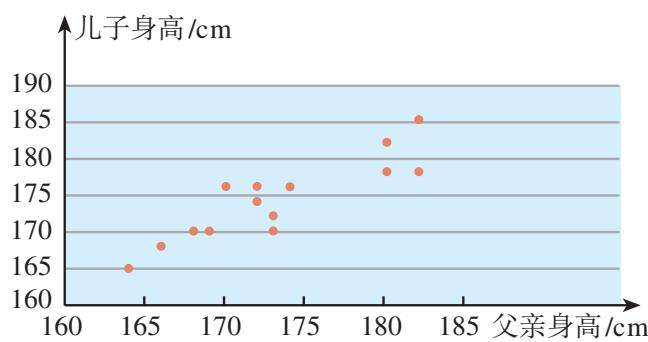

生活经验告诉我们，儿子的身高与父亲的身高不仅线性相关，而且还是正相关，即父亲的身高较高时，儿子的身高通常也较高。为了进一步研究两者之间的关系，有人调查了某所高校 14 名男大学生的身高及其父亲的身高，得到的数据如表 8.2-1 所示。

表8.2-1

<table><tr><td>编号</td><td>1</td><td>2</td><td>3</td><td>4</td><td>5</td><td>6</td><td>7</td><td>8</td><td>9</td><td>10</td><td>11</td><td>12</td><td>13</td><td>14</td></tr><tr><td>父亲身高/cm</td><td>174</td><td>170</td><td>173</td><td>169</td><td>182</td><td>172</td><td>180</td><td>172</td><td>168</td><td>166</td><td>182</td><td>173</td><td>164</td><td>180</td></tr><tr><td>儿子身高/cm</td><td>176</td><td>176</td><td>170</td><td>170</td><td>185</td><td>176</td><td>178</td><td>174</td><td>170</td><td>168</td><td>178</td><td>172</td><td>165</td><td>182</td></tr></table>

以横轴表示父亲身高、纵轴表示儿子身高建立直角坐标系，将表 8.2-1 中的成对样本数据表示为散点图，如图 8.2-1 所示。可以发现，散点大致分布在一条从左下角到右上角的直线附近，表明儿子身高和父亲身高线性相关。利用统计软件，求得样本相关系数为 $r\approx0.886$ ，表明儿子身高和父亲身高正线性相关，且相关程度较高。

  
图8.2-1

在表 8.2-1 的数据中，存在父亲身高相同，而儿子身高不同的情况。例如，第 6 个和第 8 个观测的父亲身高均为 $172\ \mathrm{cm}$ ，而对应的儿子身高分别为 $176\ \mathrm{cm}$ 和 $174\ \mathrm{cm}$ ；同样，第 3，4 两个观测中，儿子身高都是 $170\ \mathrm{cm}$ ，而父亲身高分别为 $173\ \mathrm{cm}$ 和 $169\ \mathrm{cm}$ 。可见儿子身高和父亲身高之间不是函数关系，也就不能用函数模型刻画。

图 8.2-1 中的散点大致分布在一条直线附近，表明儿子身高和父亲身高这两个变量之间有较强的线性相关关系，因此我们可以用一次函数来刻画父亲身高对儿子身高的影响，而把影响儿子身高的其他因素，如母亲身高、生活环境、饮食习惯等作为随机误差，得到刻画两个变量之间关系的线性回归模型。其中，随机误差是一个随机变量。

用 $x$ 表示父亲身高， $Y$ 表示儿子身高， $e$ 表示随机误差。假定随机误差 $e$ 的均值为 0，方差为与父亲身高无关的定值 $\sigma^2$ ，则它们之间的关系可以表示为

$$
\left\{ \begin{array}{l} Y = b x + a + e, \\ E (e) = 0, \quad D (e) = \sigma^ {2}. \end{array} \right.\tag{1}
$$

我们称（1）式为 $Y$ 关于 $x$ 的一元线性回归模型（simple linear regression model）。其中， $Y$ 称为因变量或响应变量， $x$ 称为自变量或解释变量； $a$ 和 $b$ 为模型的未知参数， $a$ 称为截距参数， $b$ 称为斜率参数； $e$ 是 $Y$ 与 $bx + a$ 之间的随机误差。模型中的 $Y$ 也是随机变量，其值虽然不能由变量 $x$ 的值确定，但是却能表示为 $bx + a$ 与 $e$ 的和（叠加），前一部分由 $x$ 所确定，后一部分是随机的。如果 $e = 0$ ，那么 $Y$ 与 $x$ 之间的关系就可用一元线性函数模型来描述。

对于父亲身高 $x$ 和儿子身高 $Y$ 的一元线性回归模型（1），可以解释为父亲身高为 $x_{i}$ 的所有男大学生的身高组成一个子总体，该子总体的均值为 $bx_{i} + a$ ，即该子总体的均值与父亲身高是线性函数关系．而对于父亲身高为 $x_{i}$ 的某一名男大学生，他的身高 $y_{i}$ 并不一定为 $bx_{i} + a$ ，它仅是该子总体中的一个观测值，这个观测值与均值有一个误差项 $e_i = y_i - (bx_i + a)$ .

以研究儿子身高与父亲身高的关系为例，产生模型（1）中随机误差 $e$ 的主要原因有：

（1）除父亲身高外，其他可能影响儿子身高的因素，比如母亲身高、生活环境、饮食习惯和锻炼时间等；

（2）在测量儿子身高时，由于测量工具、测量精度所产生的测量误差；

（3）实际问题中，我们不知道儿子身高和父亲身高的真实函数关系是什么，而利用一元线性回归模型来近似这种关系，这种近似也是产生随机误差 $e$ 的原因.
