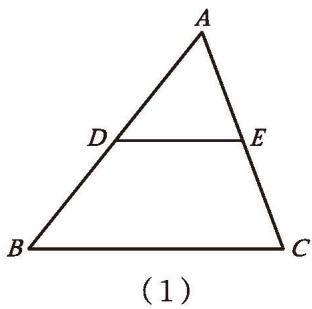
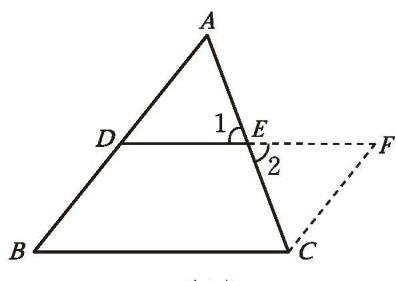

连接三角形两边中点的线段叫作三角形的中位线。

可以发现：三角形的中位线平行于第三边，且等于第三边的一半。请你尝试证明这一结论。

已知：如图 6-20（1），DE 是 $\triangle ABC$ 的中位线。

求证: $DE \parallel BC$ , $DE = \frac{1}{2} BC$ 。

分析：为证明一条线段等于另一条线段的一半，可否把问题先转化为证明与之有关的某两条线段相等？怎样获得与目标线段相等的线段？前面小明的做法对你有哪些启发？

图6-20

证明：如图 6-20（2），延长 DE 至 F，使 FE = DE，连接 CF。

在 $\triangle ADE$ 和 $\triangle CFE$ 中，

$$
\because A E = C E, \angle 1 = \angle 2, D E = F E,
$$

$$
\therefore \quad \angle A = \angle E C F, A D = C F _ {\circ}
$$

$$
\therefore C F \parallel A B _ {\circ}
$$

$$
\because B D = A D,
$$

$$
\therefore C F = B D _ {\circ}
$$

∴ 四边形 DBCF 是平行四边形（一组对边平行且相等的四边形是平行四边形）。

∴ $DF \parallel BC$ (平行四边形的定义),

DF=BC（平行四边形的对边相等）。

$$
\therefore \quad D E / / B C, D E = \frac {1}{2} B C _ {\circ}
$$

三角形的中位线定理 三角形的中位线平行于第三边，且等于第三边的一半。

利用三角形的中位线定理可以证明小明分割的四个小三角形全等。
