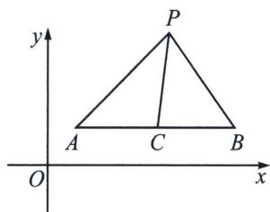
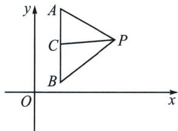

# 三角形中线的斜率与倒数和关系

## 2026版高中《mst老唐说题》圆锥曲线专题（数学）

## 四、平行于坐标系的中点斜率翻译

如图，PC 为 $\triangle PAB$ 的中线，设直线 AP，BP，CP 的斜率分别为 $k_{1}$ ， $k_{2}$ ， $k_{3}$ ，

①若 $AB$ 与 $x$ 轴平行，则： $\frac{1}{k_1} +\frac{1}{k_2} = \frac{2}{k_3}$ ；②若 $AB$ 与 $y$ 轴平行，则： $k_{1} + k_{2} = 2k_{3}$

## 相关原子

- [平面向量数量积的坐标表示](%E5%B9%B3%E9%9D%A2%E5%90%91%E9%87%8F%E6%95%B0%E9%87%8F%E7%A7%AF%E7%9A%84%E5%9D%90%E6%A0%87%E8%A1%A8%E7%A4%BA.md)
- [直线的倾斜角与斜率](%E7%9B%B4%E7%BA%BF%E7%9A%84%E5%80%BE%E6%96%9C%E8%A7%92%E4%B8%8E%E6%96%9C%E7%8E%87.md)

## 所属组织

- [四、平行于坐标系的中点斜率翻译](../%E9%A2%98%E5%9E%8B/%E6%8C%89%E9%A2%98%E5%9E%8B%E5%88%86%E7%B1%BB/%E5%9C%86%E9%94%A5%E6%9B%B2%E7%BA%BF/%E5%9C%86%E9%94%A5%E6%9B%B2%E7%BA%BF%E5%B8%B8%E8%A7%84%E6%95%B0%E6%8D%AE%E5%A4%84%E7%90%86%E6%96%B9%E6%B3%95/%E7%AC%AC%E4%BA%8C%E8%8A%82_%E9%9A%90%E8%97%8F%E7%9A%84%E6%96%9C%E7%8E%87%E5%92%8C%E7%A7%AF%E9%97%AE%E9%A2%98/%E5%9B%9B_%E5%B9%B3%E8%A1%8C%E4%BA%8E%E5%9D%90%E6%A0%87%E7%B3%BB%E7%9A%84%E4%B8%AD%E7%82%B9%E6%96%9C%E7%8E%87%E7%BF%BB%E8%AF%91.md)

## 题型训练 · 2026版高中《mst老唐说题》圆锥曲线专题（数学）

### 圆锥曲线常规数据处理方法 / 第二节 隐藏的斜率和积问题

> [!example]- 四、平行于坐标系的中点斜率翻译
> 
