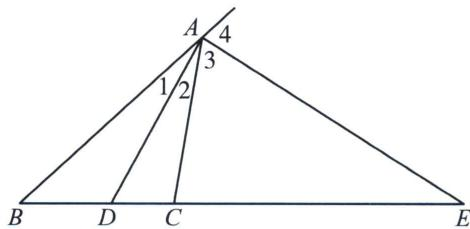

# 三角形内外角平分线的调和分割

## 2026版高中《mst老唐说题》圆锥曲线专题（数学）

## 第三节 角平分线与调和点列

根据三角形的内角平分线定理: 在 $\triangle ABC$ 中, 若 $AD$ 是 $\angle BAC$ 的内角平分线, 则有 $\frac{AB}{AC} = \frac{BD}{DC}$ , $AE$ 是 $\angle BAC$ 的外角平分线, 则有 $\frac{AB}{AC} = \frac{BE}{EC}$ , 所以 $B 、 C 、 D 、 E$ 是调和点列.

## 相关原子

- [平面向量数量积的坐标表示](%E5%B9%B3%E9%9D%A2%E5%90%91%E9%87%8F%E6%95%B0%E9%87%8F%E7%A7%AF%E7%9A%84%E5%9D%90%E6%A0%87%E8%A1%A8%E7%A4%BA.md)
