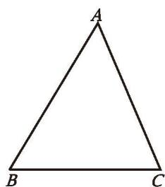
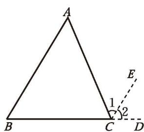

已知：如图 1-2， $\triangle ABC$ 。

求证： $\angle A + \angle B + \angle C = 180^{\circ}$

分析：你学过哪些与 $180^{\circ}$ 有关的结论？曾经的撕角拼图活动对你有什么启发？

图 1-2

证明：如图 1-3，延长 BC 至 D，过点 C 作射线 CE，使 CE // BA，则

图1-3

这里的 CD, CE 称为辅助线, 辅助线通常画成虚线。

$$
\angle 1 = \angle A, \angle 2 = \angle B _ {\circ}
$$

∵ 点 B, C, D 在同一条直线上，

$$
\therefore \angle 1 + \angle 2 + \angle A C B = 180 ^ {\circ} 。
$$

$$
\therefore \angle A + \angle B + \angle A C B = 180 ^ {\circ}
$$

三角形内角和定理 三角形三个内角的和等于 $180^{\circ}$ 。
