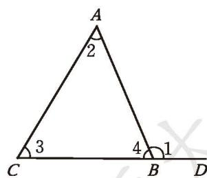

# 三角形外角的概念

## 情境引入与思考

## 知识讲解

### 北师大版初中数学·八年级下册

△ABC 内角的一条边与另一条边的反向延长线所组成的角，叫作 △ABC 的外角（exterior angle）。如图 1-6，∠1 是 △ABC 的一个外角。你能在图中画出 △ABC 的其他外角吗？

图1-6

## 本节例题与练习

- [1.1 随堂练习第3题](../%E4%B9%A0%E9%A2%98/Q070000002783.md)
- [1.1 随堂练习第4题](../%E4%B9%A0%E9%A2%98/Q070000002784.md)
- [例2 利用三角形外角性质证明两直线平行](../%E4%B9%A0%E9%A2%98/Q070000002781.md)
- [例3 利用三角形外角不等推论证明角的大小关系](../%E4%B9%A0%E9%A2%98/Q070000002782.md)

## 所属组织

- [三角形的外角及性质推论](../%E7%9F%A5%E8%AF%86%E4%B8%B2%E8%81%94/%E5%8C%97%E5%B8%88%E5%A4%A7-%E5%85%AB%E5%B9%B4%E7%BA%A7%E4%B8%8B%E5%86%8C/%E7%AC%AC%E4%B8%80%E7%AB%A0%20%E4%B8%89%E8%A7%92%E5%BD%A2%E7%9A%84%E8%AF%81%E6%98%8E%E5%8F%8A%E5%85%B6%E5%BA%94%E7%94%A8/1%20%E4%B8%89%E8%A7%92%E5%BD%A2%E5%86%85%E8%A7%92%E5%92%8C%E5%AE%9A%E7%90%86/%E4%B8%89%E8%A7%92%E5%BD%A2%E7%9A%84%E5%A4%96%E8%A7%92%E5%8F%8A%E6%80%A7%E8%B4%A8%E6%8E%A8%E8%AE%BA.md)

## 相关练习组织（范围关联）

- [三角形的外角及性质推论](../%E9%A2%98%E5%9E%8B/%E6%8C%89%E7%AB%A0%E8%8A%82%E5%88%86%E7%B1%BB/%E5%8C%97%E5%B8%88%E5%A4%A7-%E5%85%AB%E5%B9%B4%E7%BA%A7%E4%B8%8B%E5%86%8C/%E7%AC%AC%E4%B8%80%E7%AB%A0%20%E4%B8%89%E8%A7%92%E5%BD%A2%E7%9A%84%E8%AF%81%E6%98%8E%E5%8F%8A%E5%85%B6%E5%BA%94%E7%94%A8/%E4%B8%89%E8%A7%92%E5%BD%A2%E5%86%85%E8%A7%92%E5%92%8C%E5%AE%9A%E7%90%86.md)
