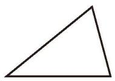
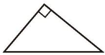
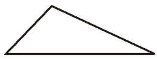
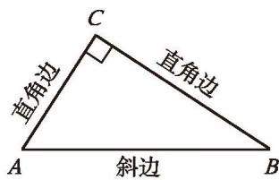

我们可以按三角形内角的大小把三角形分为三类:

⑦
①
⑤
④

<table><tr><td></td><td></td><td></td></tr><tr><td>锐角三角形(acute triangle)三个内角都是锐角</td><td>直角三角形(right triangle)有一个内角是直角</td><td>钝角三角形(obtuse triangle)有一个内角是钝角</td></tr></table>

通常, 我们用符号 “Rt△ABC” 表示 “直角三角形 $ABC$ ”。如图 4-8, 直角所对的边称为直角三角形的斜边 (hypotenuse), 夹直角的两条边称为直角三角形的直角边 (leg)。

图4-8
