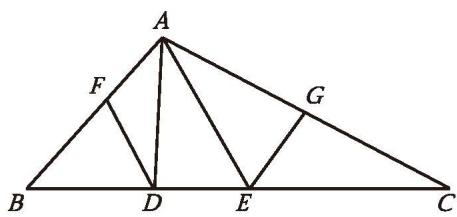
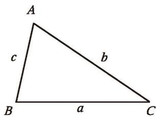

# 三角形的定义、基本元素与符号表示

## 北师大版初中数学·七年级下册

由不在同一直线上的三条线段首尾顺次相接所组成的图形叫作三角形（triangle）。三角形有三条边、三个内角和三个顶点。“三角形”可以用符号“△”表示，如图4-2中顶点是A，B，C的三角形，记作△ABC。△ABC的三边，有时也用a，b，c来表示。如图4-3，顶点A所对的边BC用a来表示，边AC、边AB分别用b，c来表示。

图4-2

图4-3
