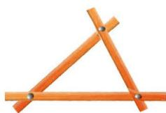
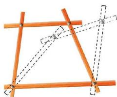
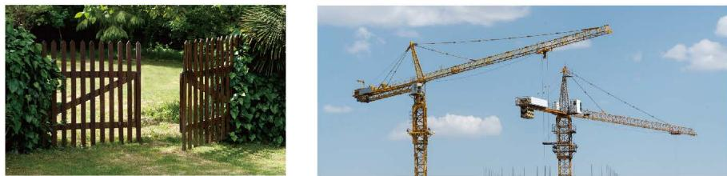

由上面的结论可知, 只要三角形三边的长度确定了, 这个三角形的形状和大小就完全确定了。图 4-22 是用三根木条钉成的一个三角形框架, 它的大小和形状是固定不变的, 三角形的这个性质叫作三角形的稳定性。图 4-23 是用四根木条钉成的一个框架, 它的形状是可以改变的, 因此, 四边形具有不稳定性。

图4-22

图4-23

图4-24

在生活中，我们经常会看到应用三角形稳定性的例子（如图4-24）。

你还能举出一些其他的例子吗？
