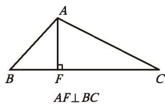
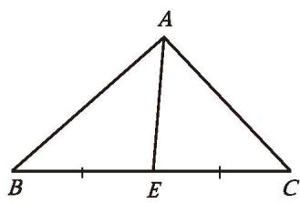
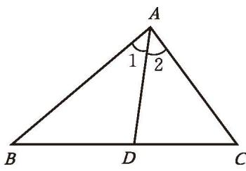

# 三角形的高线、中线与角平分线的概念

## 情境引入与思考

## 知识讲解

### 北师大版初中数学·七年级下册

图4-15

从三角形的一个顶点向它的对边所在直线作垂线，顶点和垂足之间的线段叫作三角形的高线，简称三角形的高（height）。如图4-15，线段 $AF$ 是 $\triangle ABC$ 的 $BC$ 边上的高。

在三角形中，连接一个顶点与它对边中点的线段，叫作三角形的中线（median）。如图4-16，线段 $AE$ 是 $\triangle ABC$ 的 $BC$ 边上的中线。

$BE = EC$
图4-16

图4-17

在三角形中，一个内角的角平分线与它的对边相交，这个角的顶点与交点之间的线段叫作三角形的角平分线。如图 4-17，线段 AD 是 $\triangle ABC$ 的一条角平分线。

## 后续知识

- [三角形三条中线交于一点（三角形的重心）](%E4%B8%89%E8%A7%92%E5%BD%A2%E4%B8%89%E6%9D%A1%E4%B8%AD%E7%BA%BF%E4%BA%A4%E4%BA%8E%E4%B8%80%E7%82%B9%EF%BC%88%E4%B8%89%E8%A7%92%E5%BD%A2%E7%9A%84%E9%87%8D%E5%BF%83%EF%BC%89.md)

## 本节例题与练习

- [随堂练习 4.1.3-1](../%E4%B9%A0%E9%A2%98/Q070000000216.md)
- [随堂练习 4.1.3-2](../%E4%B9%A0%E9%A2%98/Q070000000217.md)

## 所属组织

- [4.1.3 三角形的高、中线与角平分线](../%E7%9F%A5%E8%AF%86%E4%B8%B2%E8%81%94/%E5%8C%97%E5%B8%88%E5%A4%A7-%E4%B8%83%E5%B9%B4%E7%BA%A7%E4%B8%8B%E5%86%8C/%E7%AC%AC%E5%9B%9B%E7%AB%A0%20%E4%B8%89%E8%A7%92%E5%BD%A2/1%20%E8%AE%A4%E8%AF%86%E4%B8%89%E8%A7%92%E5%BD%A2/4.1.3%20%E4%B8%89%E8%A7%92%E5%BD%A2%E7%9A%84%E9%AB%98%E3%80%81%E4%B8%AD%E7%BA%BF%E4%B8%8E%E8%A7%92%E5%B9%B3%E5%88%86%E7%BA%BF.md)

## 相关练习组织（范围关联）

- [4.1.3 三角形的高、中线与角平分线](../%E9%A2%98%E5%9E%8B/%E6%8C%89%E7%AB%A0%E8%8A%82%E5%88%86%E7%B1%BB/%E5%8C%97%E5%B8%88%E5%A4%A7-%E4%B8%83%E5%B9%B4%E7%BA%A7%E4%B8%8B%E5%86%8C/%E7%AC%AC%E5%9B%9B%E7%AB%A0%20%E4%B8%89%E8%A7%92%E5%BD%A2/%E8%AE%A4%E8%AF%86%E4%B8%89%E8%A7%92%E5%BD%A2.md)
