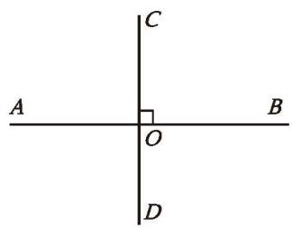
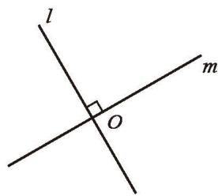

两条直线相交成四个角，如果有一个角是直角，那么称这两条直线互相垂直（perpendicular），其中的一条直线叫作另一条直线的垂线，它们的交点叫作垂足。

通常用符号 “⊥” 表示两条直线互相垂直。如图 2-6，直线 AB 与直线 CD 垂直，记作 $AB \perp CD$ ；如图 2-7，直线 l 与直线 m 垂直，记作 $l \perp m$ 。其中，点 O 是垂足。

图2-6

图2-7
