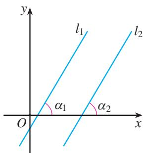

# 两条直线平行与垂直的斜率判定

## 高中选择性必修 第一册·人教A版数学

思考

我们知道，平面中两条直线有两种位置关系：相交、平行．当两条直线 $l_{1}$ 与直线 $l_{2}$ 平行时，它们的斜率 $k_{1}$ 与 $k_{2}$ 满足什么关系？

若没有特别说明，说“两条直线 $l_{1}, l_{2}$ ”时，指两条不重合的直线.

如图2.1-7，若 $l_{1} / / l_{2}$ ，则 $l_{1}$ 与 $l_{2}$ 的倾斜角 $\alpha_{1}$ 与 $\alpha_{2}$ 相等，由 $\alpha_{1} = \alpha_{2}$ ，可得 $\tan \alpha_{1} = \tan \alpha_{2}$ ，即 $k_{1} = k_{2}$ 。因此，

$$
l _ {1} / / l _ {2}
$$

$$
k _ {1} = k _ {2}
$$

反之，当 $k_{1}=k_{2}$ 时， $\tan\alpha_{1}=\tan\alpha_{2}$ ，由倾斜角的取值范围及正切函数的单调性可知， $\alpha_{1}=\alpha_{2}$ ，因此 $l_{1}//l_{2}$ .

于是，对于斜率分别为 $k_{1}$ ， $k_{2}$ 的两条直线 $l_{1}$ ， $l_{2}$ ，有

  
图2.1-7

$$
l _ {1} / / l _ {2} \Longleftrightarrow k _ {1} = k _ {2}.
$$

显然，当 $\alpha_{1} = \alpha_{2} = 90^{\circ}$ 时，直线的斜率不存在，此时 $l_{1} / / l_{2}$

若直线 $l_{1}$ ， $l_{2}$ 重合，此时仍然有 $k_{1}=k_{2}$ 。用斜率证明三点共线时，常常用到这个结论。
