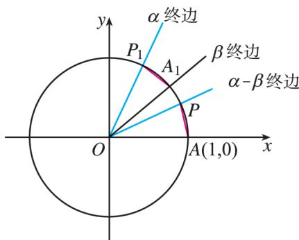

# 两角差的余弦公式

探究

如果已知任意角 $\alpha$ ， $\beta$ 的正弦、余弦，能由此推出 $\alpha + \beta$ ， $\alpha - \beta$ 的正弦、余弦吗？

下面，我们来探究 $\cos(\alpha-\beta)$ 与角 $\alpha$ ， $\beta$ 的正弦、余弦之间的关系.

不妨令 $\alpha\neq2k\pi+\beta,\ k\in Z.$

如图 5.5-1，设单位圆与 x 轴的正半轴相交于点 A(1, 0)，以 x 轴非负半轴为始边作角 $\alpha$ ， $\beta$ ， $\alpha - \beta$ ，它们的终边分别与单位圆相交于点 $P_{1}(\cos \alpha, \sin \alpha)$ ， $A_{1}(\cos \beta, \sin \beta)$ ， $P(\cos (\alpha - \beta), \sin (\alpha - \beta))$ 。

  
图5.5-1

连接 $A_{1}P_{1}$ ，AP。若把扇形 OAP 绕着点 O 旋转 $\beta$ 角，则点 A，P 分别与点 $A_{1}$ ， $P_{1}$ 重合。根据圆的旋转对称性可知， $\widehat{AP}$ 与 $\widehat{A_{1}P_{1}}$ 重合，从而 $\widehat{AP} = \widehat{A_{1}P_{1}}$ ，所以 $AP = A_{1}P_{1}$ 。

任意一个圆绕着其圆心旋转任意角后都与原来的圆重合，这一性质叫做圆的旋转对称性.

根据两点间的距离公式，得

$$
\begin{array}{l} \left[ \cos (\alpha - \beta) - 1 \right] ^ {2} + \sin^ {2} (\alpha - \beta) \\ = (\cos \alpha - \cos \beta) ^ {2} + (\sin \alpha - \sin \beta) ^ {2}, \end{array}
$$

化简得

$$
\cos (\alpha - \beta) = \cos \alpha \cos \beta + \sin \alpha \sin \beta .
$$

平面上任意两点 $P_{1}$ $(x_{1},y_{1})$ ， $P_{2}(x_{2},y_{2})$ 间的距离公式 $P_{1}P_{2} = \sqrt{(x_{2} - x_{1})^{2} + (y_{2} - y_{1})^{2}}.$

当 $\alpha=2k\pi+\beta(k\in\mathbf{Z})$ 时，容易证明上式仍然成立.

所以，对于任意角 $\alpha$ ， $\beta$ 有

$$
\cos (\alpha - \beta) = \cos \alpha \cos \beta + \sin \alpha \sin \beta .
$$

$$
(\mathrm{C} _ {(\alpha - \beta)})
$$

此公式给出了任意角 $\alpha$ ， $\beta$ 的正弦、余弦与其差角 $\alpha - \beta$ 的余弦之间的关系，称为差角的余弦公式，简记作 $C_{(\alpha - \beta)}$ 。

## 后续知识

- [两角和的余弦公式与两角和、差的正弦公式](%E4%B8%A4%E8%A7%92%E5%92%8C%E7%9A%84%E4%BD%99%E5%BC%A6%E5%85%AC%E5%BC%8F%E4%B8%8E%E4%B8%A4%E8%A7%92%E5%92%8C%E3%80%81%E5%B7%AE%E7%9A%84%E6%AD%A3%E5%BC%A6%E5%85%AC%E5%BC%8F--000173.md)

## 本节例题与练习

- [例 1 利用差角余弦公式证明诱导公式](../%E4%B9%A0%E9%A2%98/Q4984931770697118877.md)
- [例 2 已知两角的正余弦值和所在象限求差角的余弦值](../%E4%B9%A0%E9%A2%98/Q13464017564554608851.md)
- [练习 1](../%E4%B9%A0%E9%A2%98/Q13163619416766114106.md)
- [练习 2](../%E4%B9%A0%E9%A2%98/Q16766012580332433410.md)
- [练习 3](../%E4%B9%A0%E9%A2%98/Q13241861619670992926.md)
- [练习 4](../%E4%B9%A0%E9%A2%98/Q12425822954612136229.md)
- [练习 5](../%E4%B9%A0%E9%A2%98/Q12669666326631429768.md)

## 相关原子

- [两角差的余弦公式](../%E6%A6%82%E5%BF%B5%E6%88%96%E5%85%AC%E5%BC%8F/%E4%B8%A4%E8%A7%92%E5%B7%AE%E7%9A%84%E4%BD%99%E5%BC%A6%E5%85%AC%E5%BC%8F--C20090894e45f03.md)
- [圆的旋转对称性](../%E6%A6%82%E5%BF%B5%E6%88%96%E5%85%AC%E5%BC%8F/%E5%9C%86%E7%9A%84%E6%97%8B%E8%BD%AC%E5%AF%B9%E7%A7%B0%E6%80%A7--Ca615e49d19738c.md)

## 所属组织

- [两角差的余弦公式](../%E7%9F%A5%E8%AF%86%E4%B8%B2%E8%81%94/%E4%BA%BA%E6%95%99A-%E5%BF%85%E4%BF%AE%E7%AC%AC%E4%B8%80%E5%86%8C/%E7%AC%AC%E4%BA%94%E7%AB%A0%20%E4%B8%89%E8%A7%92%E5%87%BD%E6%95%B0/5.5%20%E4%B8%89%E8%A7%92%E6%81%92%E7%AD%89%E5%8F%98%E6%8D%A2/5.5.1%20%E4%B8%A4%E8%A7%92%E5%92%8C%E4%B8%8E%E5%B7%AE%E7%9A%84%E6%AD%A3%E5%BC%A6%E3%80%81%E4%BD%99%E5%BC%A6%E5%92%8C%E6%AD%A3%E5%88%87%E5%85%AC%E5%BC%8F/%E4%B8%A4%E8%A7%92%E5%B7%AE%E7%9A%84%E4%BD%99%E5%BC%A6%E5%85%AC%E5%BC%8F.md)

## 相关练习组织（范围关联）

- [两角差的余弦公式](../%E9%A2%98%E5%9E%8B/%E4%BA%BA%E6%95%99A-%E5%BF%85%E4%BF%AE%E7%AC%AC%E4%B8%80%E5%86%8C/%E7%AC%AC%E4%BA%94%E7%AB%A0%20%E4%B8%89%E8%A7%92%E5%87%BD%E6%95%B0/5.5%20%E4%B8%89%E8%A7%92%E6%81%92%E7%AD%89%E5%8F%98%E6%8D%A2/5.5.1%20%E4%B8%A4%E8%A7%92%E5%92%8C%E4%B8%8E%E5%B7%AE%E7%9A%84%E6%AD%A3%E5%BC%A6%E3%80%81%E4%BD%99%E5%BC%A6%E5%92%8C%E6%AD%A3%E5%88%87%E5%85%AC%E5%BC%8F/%E4%B8%A4%E8%A7%92%E5%B7%AE%E7%9A%84%E4%BD%99%E5%BC%A6%E5%85%AC%E5%BC%8F.md)
