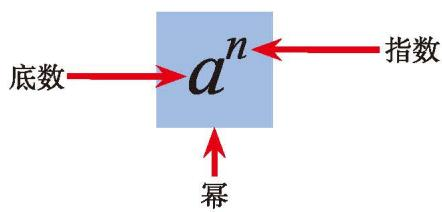

# 乘方、幂、底数与指数的概念

## 北师大版初中数学·七年级上册

一般地， $n$ 个相同的因数 $a$ 相乘，记作 $a^n$ ，即

$$
\overbrace {a \times a \times \cdots \times a} ^ {n \text {个} a} = a _ {\circ} ^ {n}
$$

这种求 n 个相同因数 a 的积的运算叫作乘方（power），乘方的结果叫作幂（power），a 叫作底数（base number），n 叫作指数（exponent）， $a^{n}$ 读作 “a 的 n 次幂”（或 “a 的 n 次方”）。

