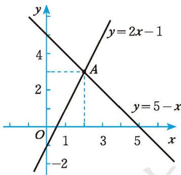

# 二元一次方程组的解与两条一次函数直线交点坐标的关系

## 北师大版初中数学·八年级上册

一次函数 $y = 5 - x$ 与 $y = 2x - 1$ 图象的交点为 $A(2,3)$ ，而 $\left\{ \begin{array}{l} x = 2, \\ y = 3 \end{array} \right.$ 就是方程组 $\left\{ \begin{array}{l} x + y = 5, \\ 2x - y = 1 \end{array} \right.$ 的解。

图5-4

一般地，从图形的角度看，确定两条直线的交点坐标，相当于求相应的二元一次方程组的解；解一个二元一次方程组相当于确定相应两条直线的交点坐标。
