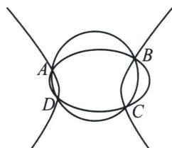
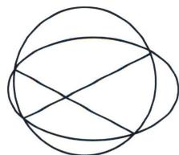

# 二次曲线四点共圆的斜率条件

## 2026版高中《mst老唐说题》圆锥曲线专题（数学）

## 三、四点共圆的充要条件与数据

四点共圆总定理：一个二次曲线 $Ax^{2} + By^{2} + Dx + Ey + F = 0$ 上四点，其中包含四点的任意两条退化的二次曲线斜率和为零，则这四点共圆.

若曲线 $Ax^{2}+By^{2}+Dx+Ey+F=0$ 与 $l_{1}: y=k_{1}x+m_{1}$ 与 $l_{2}: y=k_{2}x+m_{2}$ 有四个交点 A、B、C、D，则点共圆的充要条件是 $k_{1}+k_{2}=0$ .

注意： $l_{1}$ ： $y=k_{1}x+m_{1}$ 与 $l_{2}$ ： $y=k_{2}x+m_{2}$ 可以表示为 AB 与 CD，也可以表示为 AC 与 BD，也可以表示为 AD 与 BC，因为曲线系就是以这四点形成的退化二次曲线方程，那么包含这四点的退化二次曲线方程就

包含这三种情况，由于交叉项不存在，所以 $k_{1} + k_{2} = 0$ .

证明：由四点共圆总定理可知，两直线形成退化二次曲线的 $(k_{1}x-y+m_{1})(k_{2}x-y+m_{2})=0$ ，此时交叉项xy为0，故它们的交点共圆．本定理也可以理解为两直线形成的退化二次曲线的对称轴也是x轴与y轴的平行线，所以满足拥有两平行的对称轴的曲线系共圆.

推论：若圆锥曲线 $f_{1}(x, y)=Ax^{2}+By^{2}+Dx+Ey+F=0$ 上存在四点 P、Q、M、N，斜率互为相反数，且 PQ 是 MN 中垂线，则 $k_{MN}=\pm1$ ;

## 相关原子

- [双曲线的定义与标准方程](%E5%8F%8C%E6%9B%B2%E7%BA%BF%E7%9A%84%E5%AE%9A%E4%B9%89%E4%B8%8E%E6%A0%87%E5%87%86%E6%96%B9%E7%A8%8B.md)
- [圆的标准方程及其推导](%E5%9C%86%E7%9A%84%E6%A0%87%E5%87%86%E6%96%B9%E7%A8%8B%E5%8F%8A%E5%85%B6%E6%8E%A8%E5%AF%BC.md)
- [抛物线的定义与标准方程](%E6%8A%9B%E7%89%A9%E7%BA%BF%E7%9A%84%E5%AE%9A%E4%B9%89%E4%B8%8E%E6%A0%87%E5%87%86%E6%96%B9%E7%A8%8B.md)
- [椭圆的定义与标准方程](%E6%A4%AD%E5%9C%86%E7%9A%84%E5%AE%9A%E4%B9%89%E4%B8%8E%E6%A0%87%E5%87%86%E6%96%B9%E7%A8%8B.md)
- [直线的倾斜角与斜率](%E7%9B%B4%E7%BA%BF%E7%9A%84%E5%80%BE%E6%96%9C%E8%A7%92%E4%B8%8E%E6%96%9C%E7%8E%87.md)

## 所属组织

- [三、四点共圆的充要条件与数据](../%E9%A2%98%E5%9E%8B/%E6%8C%89%E9%A2%98%E5%9E%8B%E5%88%86%E7%B1%BB/%E5%9C%86%E9%94%A5%E6%9B%B2%E7%BA%BF/%E8%81%94%E7%AB%8B%E8%AE%A1%E7%AE%97%E9%AB%98%E9%98%B6%E7%AF%87/%E7%AC%AC%E4%BA%94%E8%8A%82_%E4%BA%8C%E6%AC%A1%E6%9B%B2%E7%BA%BF%E7%B3%BB%E4%B8%8E%E5%9B%9B%E7%82%B9%E5%85%B1%E5%9C%86/%E4%B8%89_%E5%9B%9B%E7%82%B9%E5%85%B1%E5%9C%86%E7%9A%84%E5%85%85%E8%A6%81%E6%9D%A1%E4%BB%B6%E4%B8%8E%E6%95%B0%E6%8D%AE.md)

## 题型训练 · 2026版高中《mst老唐说题》圆锥曲线专题（数学）

### 联立计算高阶篇 / 第五节 二次曲线系与四点共圆

> [!example]- 三、四点共圆的充要条件与数据
> 
