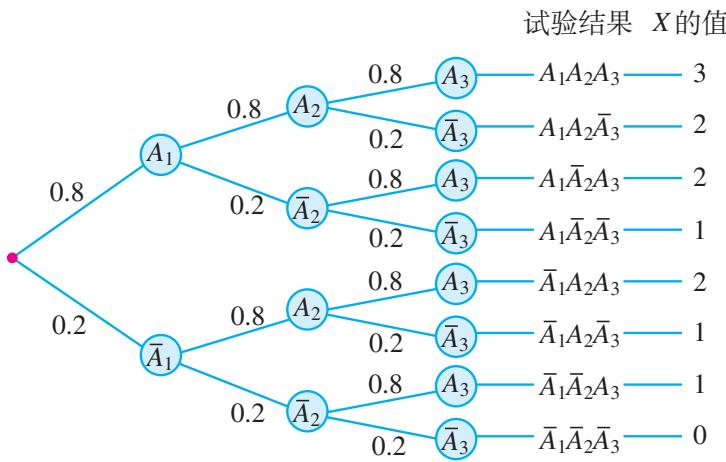

# 二项分布的概率公式

## 高中选择性必修 第三册·人教A版数学

探究

某飞碟运动员每次射击中靶的概率为0.8. 连续3次射击，中靶次数 $X$ 的概率分布列是怎样的？

用 $A_{i}$ 表示 “第 i 次射击中靶” (i=1, 2, 3)，用如图 7.4-1 的树状图表示试验的可能结果.

  
图7.4-1

由分步乘法计数原理，3次独立重复试验共有 $2^{3} = 8$ 种可能结果，它们两两互斥，每个结果都是3个相互独立事件的积。由概率的加法公式和乘法公式得

$$
P (X = 0) = P \left(\overline {{A}} _ {1} \overline {{A}} _ {2} \overline {{A}} _ {3}\right) = 0. 2 ^ {3},
$$

$$
P (X = 1) = P \left(A _ {1} \overline {{A}} _ {2} \overline {{A}} _ {3}\right) + P \left(\overline {{A}} _ {1} A _ {2} \overline {{A}} _ {3}\right) + P \left(\overline {{A}} _ {1} \overline {{A}} _ {2} A _ {3}\right) = 3 \times 0. 8 \times 0. 2 ^ {2},
$$

$$
P (X = 2) = P \left(A _ {1} A _ {2} \overline {{A}} _ {3}\right) + P \left(A _ {1} \overline {{A}} _ {2} A _ {3}\right) + P \left(\overline {{A}} _ {1} A _ {2} A _ {3}\right) = 3 \times 0. 8 ^ {2} \times 0. 2,
$$

$$
P (X = 3) = P \left(A _ {1} A _ {2} A _ {3}\right) = 0. 8 ^ {3}.
$$

为了简化表示，每次射击用1表示中靶，用0表示脱靶，那么3次射击恰好2次中靶的所有可能结果可表示为011，110，101，这三个结果发生的概率都相等，均为 $0.8^{2}\times0.2$ ，并且与哪两次中靶无关。因此，3次射击恰好2次中靶的概率为 $C_{3}^{2}\times0.8^{2}\times0.2$ 。同理可求中靶0次、1次、3次的概率。于是，中靶次数X的分布列为

$$
P (X = k) = \mathrm{C} _ {3} ^ {k} \times 0. 8 ^ {k} \times 0. 2 ^ {3 - k}, k = 0, 1, 2, 3.
$$

思考

如果连续射击4次，类比上面的分析，表示中靶次数 $X$ 等于2的结果有哪些？写出中靶次数 $X$ 的分布列.

一般地，在 n 重伯努利试验中，设每次试验中事件 A 发生的概率为 $p(0 < p < 1)$ ，用 X 表示事件 A 发生的次数，则 X 的分布列为

$$
P (X = k) = \mathrm{C} _ {n} ^ {k} p ^ {k} (1 - p) ^ {n - k}, k = 0, 1, 2, \dots , n.
$$

对比二项分布与二项式定理，你能看出它们之间的联系吗？

如果随机变量 X 的分布列具有上式的形式，则称随机变量 X 服从二项分布（binomial distribution），记作 $X \sim B(n, p)$ .

由二项式定理，容易得到

$$
\sum_ {k = 0} ^ {n} P (X = k) = \sum_ {k = 0} ^ {n} \mathrm{C} _ {n} ^ {k} p ^ {k} (1 - p) ^ {n - k} = [ p + (1 - p) ] ^ {n} = 1.
$$
