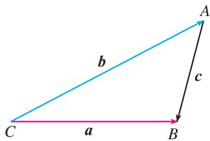

在 $\triangle ABC$ 中，三个角 $A, B, C$ 所对的边分别是 $a, b, c$ 。由于给定两边及其夹角的三角形是唯一确定的，可以用 $a, b$ 和 $C$ 表示第三边 $c$ 。因为涉及的是三角形的两边长和它们的夹角，所以考虑用向量的数量积来推导。

如图6.4-8，设 $\overrightarrow{CB} = a$ ， $\overrightarrow{CA} = b$ ， $\overrightarrow{AB} = c$ ，那么

$$
c = a - b.\tag{①}
$$

我们的研究目标是用 $|a|$ ， $|b|$ 和C表示 $|c|$ ，联想到数量积的性质 $c \cdot c = |c|^2$ ，可以考虑用向量c（即a-b）与其自身作数量积运算.

  
图6.4-8

由①得

$$
\begin{array}{r l} \left| c \right| ^ {2} & = c \cdot c = (a - b) \cdot (a - b) \\ & = a \cdot a + b \cdot b - 2 a \cdot b \\ & = a ^ {2} + b ^ {2} - 2 | a | | b | \cos C. \end{array}
$$

所以

$$
c ^ {2} = a ^ {2} + b ^ {2} - 2 a b \cos C.
$$

同理可得

$$
a ^ {2} = b ^ {2} + c ^ {2} - 2 b c \cos A,
$$

$$
b ^ {2} = c ^ {2} + a ^ {2} - 2 c a \cos B.
$$

于是，我们得到了三角形中边角关系的一个重要定理：

余弦定理（cosine theorem）三角形中任何一边的平方，等于其他两边平方的和减去这两边与它们夹角的余弦的积的两倍. 即

$$
a ^ {2} = b ^ {2} + c ^ {2} - 2 b c \cos A,
$$

$$
b ^ {2} = c ^ {2} + a ^ {2} - 2 c a \cos B,
$$

$$
c ^ {2} = a ^ {2} + b ^ {2} - 2 a b \cos C.
$$

利用余弦定理，我们可以从三角形已知的两边及其夹角直接求出第三边.

余弦定理指出了三角形的三条边与其中的一个角之间的关系。应用余弦定理，可以解决已知三角形的三边确定三角形的角的问题，由余弦定理可以得到如下推论：

$$
\cos A = \frac {b ^ {2} + c ^ {2} - a ^ {2}}{2 b c},
$$

$$
\cos B = \frac {c ^ {2} + a ^ {2} - b ^ {2}}{2 c a},
$$

$$
\cos C = \frac {a ^ {2} + b ^ {2} - c ^ {2}}{2 a b}.
$$

余弦定理及其推论把用 “SAS” 和 “SSS” 判定三角形全等的方法从数量化的角度进行了刻画.

利用推论，可以由三角形的三边直接计算出三角形的三个角.

从余弦定理及其推论可以看出，三角函数把几何中关于三角形的定性结论变成了可定量计算的公式.

勾股定理指出了直角三角形中三边之间的关系，余弦定理则指出了任意三角形中三条边与其中一个角之间的关系。如果 $\triangle ABC$ 中有一个角是直角，例如， $C = 90^{\circ}$ ，这时 $\cos C = 0$ 。由余弦定理可得 $c^{2} = a^{2} + b^{2}$ ，这就是勾股定理。由此可见，余弦定理是勾股定理的推广，而勾股定理是余弦定理的特例。

一般地，三角形的三个角 $A$ ， $B$ ， $C$ 和它们的对边 $a$ ， $b$ ， $c$ 叫做三角形的元素.已知三角形的几个元素求其他元素的过程叫做解三角形（solving a triangle).
