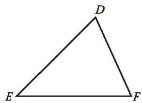

# 全等三角形的概念、性质与符号记法

## 情境引入与思考

## 知识讲解

### 北师大版初中数学·七年级下册

在生活中，我们会看到完全一样的图形，如果把它们叠在一起，它们就能够完全重合。

能够完全重合的两个三角形叫作全等三角形。例如，在图 4-19 中， $\triangle ABC$ 与 $\triangle DEF$ 能够完全重合，它们是全等三角形。其中，顶点 $A$ 与顶点 $D$ 重合，它们是对应顶点；边 $AB$ 与边 $DE$ 重合，它们是对应边； $\angle A$ 与 $\angle D$ 重合，它们是对应角。

图4-19

你还能在图 4-19 中找出其他的对应顶点、对应边和对应角吗？

全等三角形的对应边相等、对应角相等。

△ABC与△DEF全等，记作△ABC≌△DEF。记两个三角形全等时，通常把表示对应顶点的字母写在对应的位置上。

## 本节例题与练习

- [习题 4.2 第1题](../%E4%B9%A0%E9%A2%98/Q070000000235.md)
- [习题 4.2 第2题](../%E4%B9%A0%E9%A2%98/Q070000000236.md)
- [习题 4.2 第3题](../%E4%B9%A0%E9%A2%98/Q070000000237.md)
- [随堂练习 4.2-1](../%E4%B9%A0%E9%A2%98/Q070000000233.md)
- [随堂练习 4.2-2](../%E4%B9%A0%E9%A2%98/Q070000000234.md)

## 所属组织

- [2 全等三角形](../%E7%9F%A5%E8%AF%86%E4%B8%B2%E8%81%94/%E5%8C%97%E5%B8%88%E5%A4%A7-%E4%B8%83%E5%B9%B4%E7%BA%A7%E4%B8%8B%E5%86%8C/%E7%AC%AC%E5%9B%9B%E7%AB%A0%20%E4%B8%89%E8%A7%92%E5%BD%A2/2%20%E5%85%A8%E7%AD%89%E4%B8%89%E8%A7%92%E5%BD%A2/%E5%85%A8%E7%AD%89%E4%B8%89%E8%A7%92%E5%BD%A2.md)

## 相关练习组织（范围关联）

- [2 全等三角形](../%E9%A2%98%E5%9E%8B/%E6%8C%89%E7%AB%A0%E8%8A%82%E5%88%86%E7%B1%BB/%E5%8C%97%E5%B8%88%E5%A4%A7-%E4%B8%83%E5%B9%B4%E7%BA%A7%E4%B8%8B%E5%86%8C/%E7%AC%AC%E5%9B%9B%E7%AB%A0%20%E4%B8%89%E8%A7%92%E5%BD%A2/%E5%85%A8%E7%AD%89%E4%B8%89%E8%A7%92%E5%BD%A2.md)
