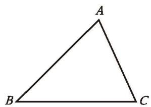
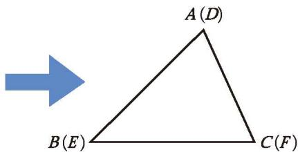

在生活中，我们会看到完全一样的图形，如果把它们叠在一起，它们就能够完全重合。

能够完全重合的两个三角形叫作全等三角形。例如，在图 4-19 中， $\triangle ABC$ 与 $\triangle DEF$ 能够完全重合，它们是全等三角形。其中，顶点 $A$ 与顶点 $D$ 重合，它们是对应顶点；边 $AB$ 与边 $DE$ 重合，它们是对应边； $\angle A$ 与 $\angle D$ 重合，它们是对应角。

图4-19

你还能在图 4-19 中找出其他的对应顶点、对应边和对应角吗？

全等三角形的对应边相等、对应角相等。

△ABC与△DEF全等，记作△ABC≌△DEF。记两个三角形全等时，通常把表示对应顶点的字母写在对应的位置上。
