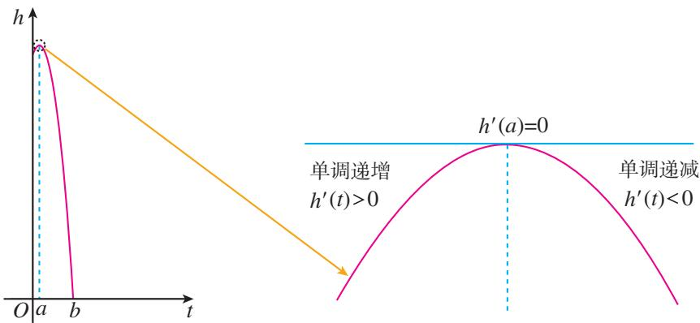
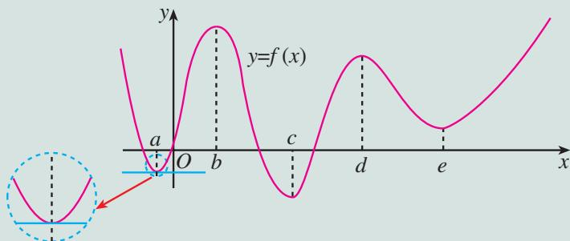

在用导数研究函数的单调性时，利用导数的正负可以判断函数的增减。下面考察函数在导数为 0 的点附近的局部性质。

以跳水运动高度函数 $h(t)$ 为例，如图 5.3-9 所示，当 $t = a$ 时，跳水运动员距水面的高度最大。放大 $t=a$ 附近函数 $h(t)$ 的图象（图 5.3-10），可以看出， $h'(a)=0$ ；在 $t=a$ 的附近，当 $t<a$ 时，函数 $h(t)$ 单调递增， $h'(t)>0$ ；当 $t>a$ 时，函数 $h(t)$ 单调递减， $h'(t)<0$ 。这就是说，在 $t=a$ 附近，函数值先增（当 $t<a$ 时， $h'(t)>0$ ）后减（当 $t>a$ 时， $h'(t)<0$ ）。这样，当 $t$ 在 $a$ 的附近从小到大经过 $a$ 时， $h'(t)$ 先正后负，且 $h'(t)$ 连续变化，于是有 $h'(a)=0$ 。

  
图5.3-9  
图5.3-10

对于一般的函数 $y = f(x)$ ，考察其图象（图 5.3-11）中 $x = a, b, c, d, e$ 等点处的函数值与导数变化特征：

  
图5.3-11

以 $x = a$ ， $b$ 两点为例，可以发现，函数 $y = f(x)$ 在点 $x = a$ 处的函数值 $f(a)$ 比它在点 $x = a$ 附近其他点处的函数值都小， $f^{\prime}(a) = 0$ ；而且在点 $x = a$ 附近的左侧 $f^{\prime}(x) < 0$ ，右侧 $f'(x)>0$ 。类似地，函数 $y=f(x)$ 在点 $x=b$ 处的函数值 $f(b)$ 比它在点 $x=b$ 附近其他点处的函数值都大， $f'(b)=0$ ；而且在点 $x=b$ 附近的左侧 $f'(x)>0$ ，右侧 $f'(x)<0$ 。

我们把 $a$ 叫做函数 $y = f(x)$ 的极小值点， $f(a)$ 叫做函数 $y = f(x)$ 的极小值； $b$ 叫做函数 $y = f(x)$ 的极大值点， $f(b)$ 叫做函数 $y = f(x)$ 的极大值。极小值点、极大值点统称为极值点，极小值和极大值统称为极值（extremum）。

极值反映了函数在某一点附近的大小情况，刻画了函数的局部性质.
