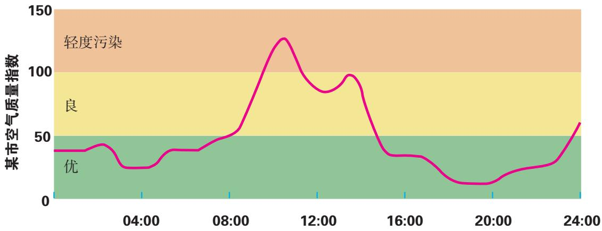

# 函数的三种表示法

## 知识讲解

我们在初中已经接触过函数的三种表示法：解析法、列表法和图象法.

解析法，就是用解析式表示两个变量之间的对应关系，如3.1.1的问题1、2.

问题 1 某 “复兴号” 高速列车加速到 350 km/h 后保持匀速运行半小时。这段时间内，列车行进的路程 s（单位：km）与运行时间 t（单位：h）的关系可以表示为

$$
s = 3 5 0 t.\tag{①}
$$

其中， $t$ 的变化范围是数集 $A_{1} = \{t \mid 0 \leqslant t \leqslant 0.5\}$ ， $s$ 的变化范围是数集 $B_{1} = \{s \mid 0 \leqslant s \leqslant 175\}$ 。对于数集 $A_{1}$ 中的任一时刻 $t$ ，按照对应关系①，在数集 $B_{1}$ 中都有唯一确定的路程 $s$ 和它对应。

问题 2 某电气维修公司要求工人每周工作至少 1 天，至多 6 天．如果公司确定的工资标准是每人每天 350 元，而且每周付一次工资，那么你认为该怎样确定一个工人每周的工资？一个工人的工资 w（单位：元）是他工作天数 d 的函数吗？

显然，工资 $w$ 是一周工作天数 $d$ 的函数，其对应关系是

$$
w = 3 5 0 d.\tag{②}
$$

其中，d 的变化范围是数集 $A_{2}=\{1,2,3,4,5,6\}$ ，w 的变化范围是数集 $B_{2}=\{350,700,1050,1400,1750,2100\}$ 。对于数集 $A_{2}$ 中的任一个工作天数 d，按照对应关系②，在数集 $B_{2}$ 中都有唯一确定的工资 w 与它对应。

列表法，就是列出表格来表示两个变量之间的对应关系，如3.1.1的问题4.

问题 4 国际上常用恩格尔系数 $r\left(r=\frac{\text{食物支出金额}}{\text{总支出金额}}\times100\%\right)$ 反映一个地区人民生活质量的高低，恩格尔系数越低，生活质量越高。表 3.1-1 是我国城镇居民恩格尔系数变化情况。

表 3.1-1 我国城镇居民恩格尔系数变化情况

<table><tr><td>年份 y</td><td>2012</td><td>2013</td><td>2014</td><td>2015</td><td>2016</td><td>2017</td><td>2018</td><td>2019</td><td>2020</td><td>2021</td></tr><tr><td>恩格尔系数 r(%)</td><td>32.0</td><td>30.1</td><td>30.0</td><td>29.7</td><td>29.3</td><td>28.6</td><td>27.7</td><td>27.6</td><td>29.2</td><td>28.6</td></tr></table>

你认为按表3.1-1给出的对应关系，恩格尔系数 $r$ 是年份 $y$ 的函数吗？如果是，你会用怎样的语言来刻画这个函数？

这里， $y$ 的取值范围是数集 $A_{4} = \{2012, 2013, 2014, 2015, 2016, 2017, 2018, 2019, 2020, 2021\}$ ；根据恩格尔系数的定义可知， $r$ 的取值范围是数集 $B_{4} = \{r \mid 0 < r \leqslant 1\}$ 。对于数集 $A_{4}$ 中的任意一个年份 $y$ ，根据表3.1-1所给定的对应关系，在数集 $B_{4}$ 中都有唯一确定的恩格尔系数 $r$ 与之对应。所以， $r$ 是 $y$ 的函数。

图象法，就是用图象表示两个变量之间的对应关系，如3.1.1的问题3.

问题3 图3.1-1是某市某日的空气质量指数（Air Quality Index，简称AQI）变化图．如何根据该图确定这一天内任一时刻 $t\mathrm{h}$ 的空气质量指数（AQI）的值 $I$ ？你认为这里的 $I$ 是 $t$ 的函数吗？

  
图3.1-1

从图3.1-1中的曲线可知， $t$ 的变化范围是数集 $A_{3} = \{t\mid 0\leqslant t\leqslant 24\}$ ，AQI的值 $I$ 都在数集 $B_{3} = \{I\mid 0 < I < 150\}$ 中．对于数集 $A_{3}$ 中的任一时刻 $t$ ，按照图3.1-1中曲线所给定的对应关系，在数集 $B_{3}$ 中都有唯一确定的AQI的值 $I$ 与之对应．因此，这里的 $I$ 是 $t$ 的函数.

这三种方法是常用的函数表示法.

## 本节例题与练习

- [个人所得税的分段函数模型](../%E4%B9%A0%E9%A2%98/Q1058647956289601303.md)
- [例 4 某种笔记本的单价是 5 元](../%E4%B9%A0%E9%A2%98/Q9980076590973766234.md)
- [例 5 画出函数 $y=|x|$ 的图](../%E4%B9%A0%E9%A2%98/Q1221035528332426823.md)
- [例 6 给定函数 $f(x)=x+1$](../%E4%B9%A0%E9%A2%98/Q12594455931049086210.md)
- [函数表示法练习](../%E4%B9%A0%E9%A2%98/Q2366723623502731207.md)
- [用函数表示成绩变化](../%E4%B9%A0%E9%A2%98/Q274522043026163346.md)
- [练习 1](../%E4%B9%A0%E9%A2%98/Q15139660637783844596.md)
- [练习 1](../%E4%B9%A0%E9%A2%98/Q3031481336785685427.md)
- [练习 2](../%E4%B9%A0%E9%A2%98/Q4804114129327328006.md)
- [练习 2](../%E4%B9%A0%E9%A2%98/Q17775897593569269047.md)

## 所属组织

- [3.1.2 函数的表示法](../%E7%9F%A5%E8%AF%86%E4%B8%B2%E8%81%94/%E4%BA%BA%E6%95%99A-%E5%BF%85%E4%BF%AE%E7%AC%AC%E4%B8%80%E5%86%8C/%E7%AC%AC%E4%B8%89%E7%AB%A0%20%E5%87%BD%E6%95%B0%E7%9A%84%E6%A6%82%E5%BF%B5%E4%B8%8E%E6%80%A7%E8%B4%A8/3.1%20%E5%87%BD%E6%95%B0%E7%9A%84%E6%A6%82%E5%BF%B5%E5%8F%8A%E5%85%B6%E8%A1%A8%E7%A4%BA/3.1.2%20%E5%87%BD%E6%95%B0%E7%9A%84%E8%A1%A8%E7%A4%BA%E6%B3%95.md)

## 相关练习组织（范围关联）

- [3.1.2 函数的表示法](../%E9%A2%98%E5%9E%8B/%E4%BA%BA%E6%95%99A-%E5%BF%85%E4%BF%AE%E7%AC%AC%E4%B8%80%E5%86%8C/%E7%AC%AC%E4%B8%89%E7%AB%A0%20%E5%87%BD%E6%95%B0%E7%9A%84%E6%A6%82%E5%BF%B5%E4%B8%8E%E6%80%A7%E8%B4%A8/3.1%20%E5%87%BD%E6%95%B0%E7%9A%84%E6%A6%82%E5%BF%B5%E5%8F%8A%E5%85%B6%E8%A1%A8%E7%A4%BA/3.1.2%20%E5%87%BD%E6%95%B0%E7%9A%84%E8%A1%A8%E7%A4%BA%E6%B3%95.md)
