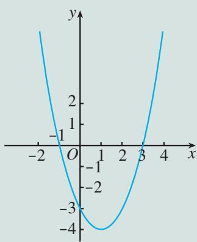

# 函数零点存在定理

探究

对于二次函数 $f(x) = x^{2} - 2x - 3$ ，观察它的图象（图4.5-1），发现它在区间[2，4]上有零点。这时，函数图象与 $x$ 轴有什么关系？在区间[-2，0]上是否也有这种关系？你认为应如何利用函数 $f(x)$ 的取值规律来刻画这种关系？

再任意画几个函数的图象，观察函数零点所在区间，以及这一区间内函数图象与 $x$ 轴的关系，并探究用 $f(x)$ 的取值刻画这种关系的方法.

  
图4.5-1

可以发现，在零点附近，函数图象是连续不断的，并且“穿过” $x$ 轴。函数在端点 $x = 2$ 和 $x = 4$ 的取值异号，即 $f(2)f(4) < 0$ ，函数 $f(x) = x^2 - 2x - 3$ 在区间（2，4）内有零点 $x = 3$ ，它是方程 $x^2 - 2x - 3 = 0$ 的一个根。同样地， $f(-2)f(0) < 0$ ，函数 $f(x) = x^2 - 2x - 3$ 在 $(-2, 0)$ 内有零点 $x = -1$ ，它是方程 $x^2 - 2x - 3 = 0$ 的另一个根。

一般地，我们有：

[函数零点存在定理](../%E6%A6%82%E5%BF%B5%E6%88%96%E5%85%AC%E5%BC%8F/%E5%87%BD%E6%95%B0%E9%9B%B6%E7%82%B9%E5%AD%98%E5%9C%A8%E5%AE%9A%E7%90%86--C87a17c7576774a.md) 如果函数 $y = f(x)$ 在区间 $[a, b]$ 上的图象是一条连续不断的曲线，且有 $f(a)f(b) < 0$ ，那么，函数 $y = f(x)$ 在区间 $(a, b)$ 内至少有一个零点，即存在 $c \in (a, b)$ ，使得 $f(c) = 0$ ，这个 $c$ 也就是方程 $f(x) = 0$ 的解.

## 先修知识

- [函数的零点与方程的解](%E5%87%BD%E6%95%B0%E7%9A%84%E9%9B%B6%E7%82%B9%E4%B8%8E%E6%96%B9%E7%A8%8B%E7%9A%84%E8%A7%A3--000147.md)

## 后续知识

- [用二分法求方程近似解](%E7%94%A8%E4%BA%8C%E5%88%86%E6%B3%95%E6%B1%82%E6%96%B9%E7%A8%8B%E8%BF%91%E4%BC%BC%E8%A7%A3--000149.md)

## 本节例题与练习

- [例 1 判断超越方程 ln(x)+2x-6=0 实数解的个数](../%E4%B9%A0%E9%A2%98/Q11380678563379230605.md)
- [练习 1](../%E4%B9%A0%E9%A2%98/Q15883199161830035113.md)
- [练习 2](../%E4%B9%A0%E9%A2%98/Q392362449207491877.md)

## 相关原子

- [函数零点存在定理](../%E6%A6%82%E5%BF%B5%E6%88%96%E5%85%AC%E5%BC%8F/%E5%87%BD%E6%95%B0%E9%9B%B6%E7%82%B9%E5%AD%98%E5%9C%A8%E5%AE%9A%E7%90%86--C87a17c7576774a.md)

## 所属组织

- [4.5.1 函数的零点与方程的解](../%E7%9F%A5%E8%AF%86%E4%B8%B2%E8%81%94/%E4%BA%BA%E6%95%99A-%E5%BF%85%E4%BF%AE%E7%AC%AC%E4%B8%80%E5%86%8C/%E7%AC%AC%E5%9B%9B%E7%AB%A0%20%E6%8C%87%E6%95%B0%E5%87%BD%E6%95%B0%E4%B8%8E%E5%AF%B9%E6%95%B0%E5%87%BD%E6%95%B0/4.5%20%E5%87%BD%E6%95%B0%E7%9A%84%E5%BA%94%E7%94%A8%28%E4%BA%8C%29/4.5.1%20%E5%87%BD%E6%95%B0%E7%9A%84%E9%9B%B6%E7%82%B9%E4%B8%8E%E6%96%B9%E7%A8%8B%E7%9A%84%E8%A7%A3.md)

## 相关练习组织（范围关联）

- [4.5.1 函数的零点与方程的解](../%E9%A2%98%E5%9E%8B/%E4%BA%BA%E6%95%99A-%E5%BF%85%E4%BF%AE%E7%AC%AC%E4%B8%80%E5%86%8C/%E7%AC%AC%E5%9B%9B%E7%AB%A0%20%E6%8C%87%E6%95%B0%E5%87%BD%E6%95%B0%E4%B8%8E%E5%AF%B9%E6%95%B0%E5%87%BD%E6%95%B0/4.5%20%E5%87%BD%E6%95%B0%E7%9A%84%E5%BA%94%E7%94%A8%28%E4%BA%8C%29/4.5.1%20%E5%87%BD%E6%95%B0%E7%9A%84%E9%9B%B6%E7%82%B9%E4%B8%8E%E6%96%B9%E7%A8%8B%E7%9A%84%E8%A7%A3.md)
