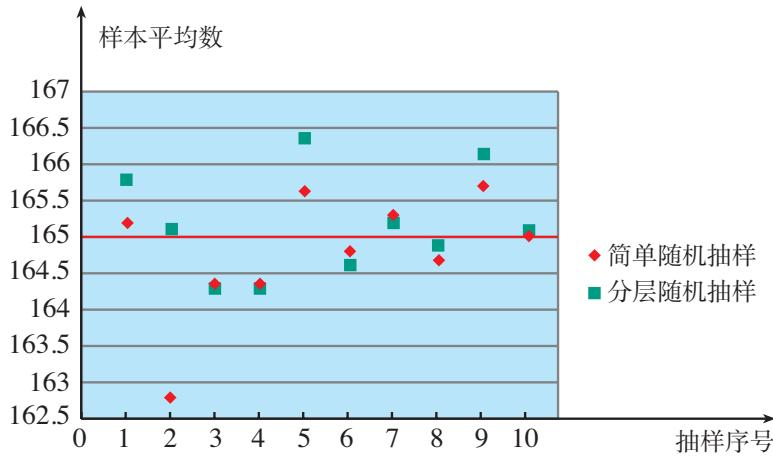

# 分层随机抽样与总体均值估计

## 情境引入与思考

## 知识讲解

### 高中必修 第二册·人教A版数学

思考

对男生、女生分别进行简单随机抽样，样本量在男生、女生中应如何分配？

自然地，为了使样本的结构与总体的分布相近，人数多的群体应多抽一些，人数少的群体应少抽一些。因此，按男生、女生在全体学生中所占的比例进行分配是一种比较合理

的方式，即

$$
\mathrm{男生样本量} = \frac {\mathrm{男生人数}}{\mathrm{全体学生数}} \times \mathrm{总样本量},
$$

$$
\mathrm{女生样本量} = \frac {\mathrm{女生人数}}{\mathrm{全体学生数}} \times \mathrm{总样本量}.
$$

这样无论是男生还是女生，每个学生被抽到的概率都相等。当总样本量为 50 时，可以计算出从男生、女生中分别应抽取的人数为

$$
n _ {\text {男}} = \frac {3 2 6}{7 1 2} \times 5 0 \approx 2 3,
$$

$$
n _ {\text {女}} = \frac {3 8 6}{7 1 2} \times 5 0 \approx 2 7.
$$

我们按上述方法抽取了一个容量为 50 的样本，其观测数据（单位：cm）如下：男生

$$
\begin{array}{l l l l l l l l l l} 1 7 3. 0 & 1 7 4. 0 & 1 6 6. 0 & 1 7 2. 0 & 1 7 0. 0 & 1 6 5. 0 & 1 6 5. 0 & 1 6 8. 0 & 1 6 4. 0 & 1 7 3. 0 \\ 1 7 2. 0 & 1 7 3. 0 & 1 7 5. 0 & 1 6 8. 0 & 1 7 0. 0 & 1 7 2. 0 & 1 7 6. 0 & 1 7 5. 0 & 1 6 8. 0 & 1 7 3. 0 \\ 1 6 7. 0 & 1 7 0. 0 & 1 7 5. 0 \end{array}
$$

女生

$$
\begin{array}{l l l l l l l l l l} 1 6 3. 0 & 1 6 4. 0 & 1 6 1. 0 & 1 5 7. 0 & 1 6 2. 0 & 1 6 5. 0 & 1 5 8. 0 & 1 5 5. 0 & 1 6 4. 0 & 1 6 2. 5 \\ 1 5 4. 0 & 1 5 4. 0 & 1 6 4. 0 & 1 4 9. 0 & 1 5 9. 0 & 1 6 1. 0 & 1 7 0. 0 & 1 7 1. 0 & 1 5 5. 0 & 1 4 8. 0 \\ 1 7 2. 0 & 1 6 2. 5 & 1 5 8. 0 & 1 5 5. 5 & 1 5 7. 0 & 1 6 3. 0 & 1 7 2. 0 \end{array}
$$

通过计算，得出男生和女生身高的样本平均数分别为 170.6，160.6。根据男生、女生身高的样本平均数以及他们各自的人数，可以估计总体平均数为

$$
\frac {1 7 0 . 6 \times 3 2 6 + 1 6 0 . 6 \times 3 8 6}{7 1 2} \approx 1 6 5. 2,
$$

即估计树人中学高一年级学生的平均身高在 165.2 cm 左右.

上面我们按性别变量，把高一学生划分为男生、女生两个身高差异较小的子总体分别进行抽样，进而得到总体的估计。一般地，按一个或多个变量把总体划分成若干个子总体，每个个体属于且仅属于一个子总体，在每个子总体中独立地进行简单随机抽样，再把所有子总体中抽取的样本合在一起作为总样本，这样的抽样方法称为分层随机抽样（stratified random sampling），每一个子总体称为层。在分层随机抽样中，如果每层样本量都与层的大小成比例，那么称这种样本量的分配方式为比例分配。

在分层随机抽样中，如果层数分为2层，第1层和第2层包含的个体数分别为M和N，抽取的样本量分别为m和n．我们用 $X_{1}$ ， $X_{2}$ ，…， $X_{M}$ 表示第1层各个个体的变量值，用 $x_{1}$ ， $x_{2}$ ，…， $x_{m}$ 表示第1层样本的各个个体的变量值；用 $Y_{1}$ ， $Y_{2}$ ，…， $Y_{N}$ 表示第2层各个个体的变量值，用 $y_{1}$ ， $y_{2}$ ，…， $y_{n}$ 表示第2层样本的各个个体的变量值，则

182 第九章 统计

第1层的总体平均数和样本平均数分别为

$$
\overline {{{X}}} = \frac {X _ {1} + X _ {2} + \cdots + X _ {M}}{M} = \frac {1}{M} \sum_ {i = 1} ^ {M} X _ {i}, \overline {{{x}}} = \frac {x _ {1} + x _ {2} + \cdots + x _ {m}}{m} = \frac {1}{m} \sum_ {i = 1} ^ {m} x _ {i}.
$$

第2层的总体平均数和样本平均数分别为

$$
\overline {{Y}} = \frac {Y _ {1} + Y _ {2} + \cdots + Y _ {N}}{N} = \frac {1}{N} \sum_ {i = 1} ^ {N} Y _ {i}, \quad \overline {{y}} = \frac {y _ {1} + y _ {2} + \cdots + y _ {n}}{n} = \frac {1}{n} \sum_ {i = 1} ^ {n} y _ {i}.
$$

总体平均数和样本平均数分别为

$$
\overline {{{W}}} = \frac {\sum_ {i = 1} ^ {M} X _ {i} + \sum_ {i = 1} ^ {N} Y _ {i}}{M + N}, \quad \overline {{{w}}} = \frac {\sum_ {i = 1} ^ {m} x _ {i} + \sum_ {i = 1} ^ {n} y _ {i}}{m + n}.
$$

由于用第1层的样本平均数 $\overline{x}$ 可以估计第1层的总体平均数 $\overline{X}$ ，用第2层的样本平均数 $\overline{y}$ 可以估计第2层的总体平均数 $\overline{Y}$ ，因此我们可以用

$$
\frac {M \times \overline {{x}} + N \times \overline {{y}}}{M + N} = \frac {M}{M + N} \overline {{x}} + \frac {N}{M + N} \overline {{y}}
$$

估计总体平均数 $\overline{W}$ .

在比例分配的分层随机抽样中，

$$
\frac {m}{M} = \frac {n}{N} = \frac {m + n}{M + N},
$$

可得

$$
\frac {M}{M + N} \overline {{x}} + \frac {N}{M + N} \overline {{y}} = \frac {m}{m + n} \overline {{x}} + \frac {n}{m + n} \overline {{y}} = \overline {{w}}.
$$

因此，在比例分配的分层随机抽样中，我们可以直接用样本平均数 $\overline{w}$ 估计总体平均数 $\overline{W}$ .

探究

与考察简单随机抽样估计效果类似，小明也想通过多次抽样考察一下分层随机抽样的估计效果。他用比例分配的分层随机抽样方法，从高一年级的学生中抽取了10个样本量为50的样本，计算出样本平均数如表9.1-2所示。与上一小节“探究”中相同样本量的简单随机抽样的结果比较，小明有了一个重要的发现。你是否也有所发现？

表9.1-2

<table><tr><td rowspan="2">样本的“层”</td><td colspan="10">10个样本的平均数</td></tr><tr><td>1</td><td>2</td><td>3</td><td>4</td><td>5</td><td>6</td><td>7</td><td>8</td><td>9</td><td>10</td></tr><tr><td>男生样本</td><td>170.0</td><td>170.7</td><td>169.8</td><td>171.7</td><td>172.7</td><td>171.9</td><td>171.6</td><td>170.6</td><td>172.6</td><td>170.9</td></tr><tr><td>女生样本</td><td>162.2</td><td>160.3</td><td>159.7</td><td>158.1</td><td>161.1</td><td>158.4</td><td>159.7</td><td>160.0</td><td>160.6</td><td>160.2</td></tr><tr><td>总样本</td><td>165.8</td><td>165.1</td><td>164.3</td><td>164.3</td><td>166.4</td><td>164.6</td><td>165.2</td><td>164.9</td><td>166.1</td><td>165.1</td></tr></table>

我们把分层随机抽样的平均数与上一小节样本量为 50 的简单随机抽样的平均数用图形表示（图 9.1-4），其中红线表示整个年级学生身高的平均数.

  
图9.1-4

从试验结果看，分层随机抽样的样本平均数围绕总体平均数波动，与简单随机抽样的结果比较，分层随机抽样并没有明显优于简单随机抽样。但相对而言，分层随机抽样的样本平均数波动幅度更均匀，简单随机抽样中出现了一个（第2个）偏离总体平均数的幅度比较大的样本平均数，即出现了比较“极端”的样本，而分层随机抽样没有出现。

实际上，在个体之间差异较大的情形下，只要选取的分层变量合适，使得各层间差异明显、层内差异不大，分层随机抽样的效果一般会好于简单随机抽样，也好于很多其他抽样方法。分层随机抽样的组织实施也比简单随机抽样方便，而且除了能得到总体的估计外，还能得到每层的估计。

在实际抽样调查中，由于实际问题的复杂性，除了要考虑获得的样本的代表性，还要考虑调查实施中人力、物力、时间等因素，因此通常会把多种抽样方法组合起来使用。例如，在分层抽样中，不同的层内除了用简单随机抽样外，还可以用其他的抽样方法，有时层内还需要再进行分层，等等。

## 先修知识

- [简单随机抽样的概念与特征](%E7%AE%80%E5%8D%95%E9%9A%8F%E6%9C%BA%E6%8A%BD%E6%A0%B7%E7%9A%84%E6%A6%82%E5%BF%B5%E4%B8%8E%E7%89%B9%E5%BE%81.md)

## 本节例题与练习

- [练习 1](../%E4%B9%A0%E9%A2%98/Q070000000827.md)
- [练习 2](../%E4%B9%A0%E9%A2%98/Q070000000828.md)
- [练习 3](../%E4%B9%A0%E9%A2%98/Q070000000829.md)
- [练习 4](../%E4%B9%A0%E9%A2%98/Q070000000830.md)

## 所属组织

- [9.1.2 分层随机抽样](../%E7%9F%A5%E8%AF%86%E4%B8%B2%E8%81%94/%E4%BA%BA%E6%95%99A-%E5%BF%85%E4%BF%AE%E7%AC%AC%E4%BA%8C%E5%86%8C/%E7%AC%AC%E4%B9%9D%E7%AB%A0%20%E7%BB%9F%E8%AE%A1/9.1%20%E9%9A%8F%E6%9C%BA%E6%8A%BD%E6%A0%B7/9.1.2%20%E5%88%86%E5%B1%82%E9%9A%8F%E6%9C%BA%E6%8A%BD%E6%A0%B7.md)

## 相关练习组织（范围关联）

- [9.1.2 分层随机抽样](../%E9%A2%98%E5%9E%8B/%E6%8C%89%E7%AB%A0%E8%8A%82%E5%88%86%E7%B1%BB/%E4%BA%BA%E6%95%99A-%E5%BF%85%E4%BF%AE%E7%AC%AC%E4%BA%8C%E5%86%8C/%E7%AC%AC%E4%B9%9D%E7%AB%A0%20%E7%BB%9F%E8%AE%A1/9.1%20%E9%9A%8F%E6%9C%BA%E6%8A%BD%E6%A0%B7.md)
