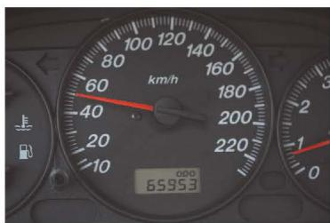
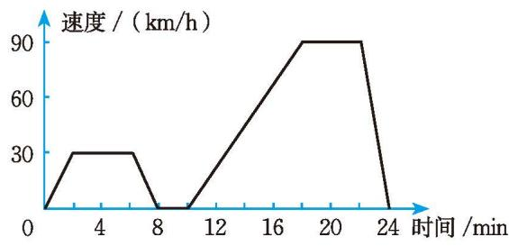

# 分析速度随时间变化的图象（分段运动状态解读）

## 北师大版初中数学·七年级下册

每一辆汽车上都有一个时速表用来指示汽车当前的速度。如图 6-8，你知道这辆汽车现在的速度是多少吗？

图6-8

图6-9

汽车在行驶过程中，速度往往是变化的。图 6-9 表示一辆汽车某次行程中 24 min 内的速度情况。

(1) 你能描述这辆汽车在这次行程中 $24 \mathrm{~min}$ 内速度的变化情况吗?

(2) 这辆汽车在哪些时间段保持匀速行驶？速度分别是多少？

(3) 这辆汽车出发后 $8 \mathrm{~min}$ 到 $10 \mathrm{~min}$ 之间可能发生了什么情况?

(4) 用自己的语言大致描述这辆汽车的行驶情况。
