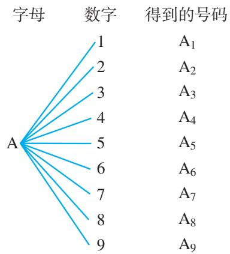

考虑如下座位编号问题：用前 6 个大写英文字母和 1～9 这 9 个阿拉伯数字，以 $A_{1}$ ， $A_{2}$ ，…， $A_{9}$ ， $B_{1}$ ， $B_{2}$ ，…的方式给教室里的一个座位编号，计算总共能编出的不同号码种数。

这里要完成的事情是“给一个座位编号”，与“用 26 个英文字母中的任意一个或 10 个阿拉伯数字中的任意一个给座位编号”的要求不同。在这个问题中，号码必须由一个英文字母和一个作为下标的阿拉伯数字组成，即得到一个号码要经过先确定一个英文字母、后确定一个阿拉伯数字这样两个步骤。用图 6.1-1 所示的“树状图”可以列出所有可能的号码。

  
图6.1-1

也可以直接按分步计数分析：由于前 6 个英文字母中的任意一个都能与 9 个数字中的任意一个组成一个号码，而且它们互不相同，因此共有

$$
6 \times 9 = 5 4
$$

种不同的号码.

这一问题最重要的特征是“和”字的出现：一个座位编号由一个英文字母和一个阿拉伯数字构成。因此得到一个座位号要经过先确定一个英文字母，后确定一个阿拉伯数字这两个步骤，每一个英文字母与不同的数字组成的号码是互不相同的。

一般地，有如下分步乘法计数原理：

完成一件事需要两个步骤 $^{①}$ ，做第 1 步有 $m$ 种不同的方法，做第 2 步有 $n$ 种不同的方法，那么完成这件事共有

$$
N = m \times n
$$

种不同的方法.

① 无论第 1 步采用哪种方法，与之对应的第 2 步都有相同的方法数.
