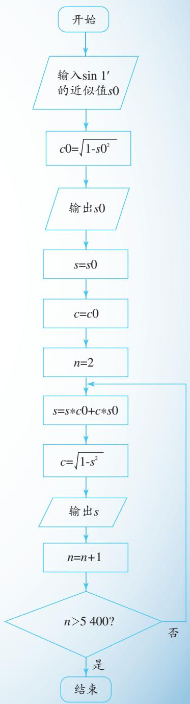

# 利用信息技术制作三角函数表

前面在“对数的发明”中曾经谈到，纳皮尔利用对数制作了 $0^{\circ} \sim 90^{\circ}$ 每隔 $1'$ 的八位三角函数表。应当说，纳皮尔仅仅凭借手工运算得到这个三角函数表的工作量是非常大的，这也显示出他超人的毅力和为科学献身的精神。今天，我们可以利用已经学会的三角函数知识以及算法知识，借助信息技术，容易地制作出非常精确的三角函数表。下面我们借助信息技术来作一个 $0^{\circ} \sim 90^{\circ}$ 每隔 $1'$ 的八位三角函数表。

用计算工具可得：

$\sin 1^{\prime}\approx 2.908882046\times 10^{-4}\\ \approx 0.000290888.$

以此作为初始值，利用

$$
\begin{array}{c} \cos 1 ^ {\prime} = \sqrt {1 - \sin^ {2} 1 ^ {\prime}}; \\ \alpha_ {0} = 1 ^ {\prime}, \alpha_ {n} = \alpha_ {n - 1} + 1 ^ {\prime}, n \geqslant 1; \\ \sin \alpha_ {n} = \sin 1 ^ {\prime} \cos \alpha_ {n - 1} + \cos 1 ^ {\prime} \sin \alpha_ {n - 1}, \\ \cos \alpha_ {n} = \sqrt {1 - \sin^ {2} \alpha_ {n}}, \end{array}
$$

就可以写出一个程序框图（如右图所示），然后通过信息技术得到一个正弦函数的三角函数表.

请同学们根据上述思路，自己编写程序，得出一个三角函数表.

## 本节例题与练习

- [习题5.5 复习巩固 第10题](../%E4%B9%A0%E9%A2%98/Q14401148894272165508.md)
- [习题5.5 复习巩固 第11题](../%E4%B9%A0%E9%A2%98/Q4206357184499733269.md)
- [习题5.5 复习巩固 第11题](../%E4%B9%A0%E9%A2%98/Q15692143071786255970.md)
- [习题5.5 复习巩固 第12题](../%E4%B9%A0%E9%A2%98/Q932149201716569922.md)
- [习题5.5 复习巩固 第1题](../%E4%B9%A0%E9%A2%98/Q714547484068240852.md)
- [习题5.5 复习巩固 第2题](../%E4%B9%A0%E9%A2%98/Q17610040625448271618.md)
- [习题5.5 复习巩固 第3题](../%E4%B9%A0%E9%A2%98/Q6150259744579812719.md)
- [习题5.5 复习巩固 第4题](../%E4%B9%A0%E9%A2%98/Q16383092779339121892.md)
- [习题5.5 复习巩固 第5题](../%E4%B9%A0%E9%A2%98/Q16148227249858765229.md)
- [习题5.5 复习巩固 第7题](../%E4%B9%A0%E9%A2%98/Q1302794955770009612.md)
- [习题5.5 复习巩固 第8题](../%E4%B9%A0%E9%A2%98/Q12974526483629365064.md)
- [习题5.5 复习巩固 第9题](../%E4%B9%A0%E9%A2%98/Q12520626949011669700.md)
- [习题5.5 拓广探索 第18题](../%E4%B9%A0%E9%A2%98/Q15980247151994419077.md)
- [习题5.5 拓广探索 第19题](../%E4%B9%A0%E9%A2%98/Q8640515770803943364.md)
- [习题5.5 拓广探索 第20题](../%E4%B9%A0%E9%A2%98/Q12020419151005203583.md)
- [习题5.5 综合运用 第13题](../%E4%B9%A0%E9%A2%98/Q4094455736321143633.md)
- [习题5.5 综合运用 第14题](../%E4%B9%A0%E9%A2%98/Q5130139863258469520.md)
- [习题5.5 综合运用 第15题](../%E4%B9%A0%E9%A2%98/Q5362362442034285388.md)
- [习题5.5 综合运用 第16题](../%E4%B9%A0%E9%A2%98/Q18163387905695742543.md)

## 所属组织

- [信息技术应用 利用信息技术制作三角函数表](../%E7%9F%A5%E8%AF%86%E4%B8%B2%E8%81%94/%E4%BA%BA%E6%95%99A-%E5%BF%85%E4%BF%AE%E7%AC%AC%E4%B8%80%E5%86%8C/%E7%AC%AC%E4%BA%94%E7%AB%A0%20%E4%B8%89%E8%A7%92%E5%87%BD%E6%95%B0/%E4%BF%A1%E6%81%AF%E6%8A%80%E6%9C%AF%E5%BA%94%E7%94%A8%20%E5%88%A9%E7%94%A8%E4%BF%A1%E6%81%AF%E6%8A%80%E6%9C%AF%E5%88%B6%E4%BD%9C%E4%B8%89%E8%A7%92%E5%87%BD%E6%95%B0%E8%A1%A8/%E4%BF%A1%E6%81%AF%E6%8A%80%E6%9C%AF%E5%BA%94%E7%94%A8%20%E5%88%A9%E7%94%A8%E4%BF%A1%E6%81%AF%E6%8A%80%E6%9C%AF%E5%88%B6%E4%BD%9C%E4%B8%89%E8%A7%92%E5%87%BD%E6%95%B0%E8%A1%A8.md)

## 相关练习组织（范围关联）

- [信息技术应用 利用信息技术制作三角函数表](../%E9%A2%98%E5%9E%8B/%E4%BA%BA%E6%95%99A-%E5%BF%85%E4%BF%AE%E7%AC%AC%E4%B8%80%E5%86%8C/%E7%AC%AC%E4%BA%94%E7%AB%A0%20%E4%B8%89%E8%A7%92%E5%87%BD%E6%95%B0/%E4%BF%A1%E6%81%AF%E6%8A%80%E6%9C%AF%E5%BA%94%E7%94%A8%20%E5%88%A9%E7%94%A8%E4%BF%A1%E6%81%AF%E6%8A%80%E6%9C%AF%E5%88%B6%E4%BD%9C%E4%B8%89%E8%A7%92%E5%87%BD%E6%95%B0%E8%A1%A8/%E4%BF%A1%E6%81%AF%E6%8A%80%E6%9C%AF%E5%BA%94%E7%94%A8%20%E5%88%A9%E7%94%A8%E4%BF%A1%E6%81%AF%E6%8A%80%E6%9C%AF%E5%88%B6%E4%BD%9C%E4%B8%89%E8%A7%92%E5%87%BD%E6%95%B0%E8%A1%A8.md)
