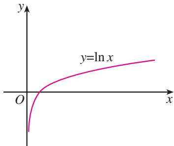
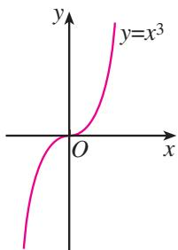

对数函数 $y = \ln x$ 的导数为 $y' = \frac{1}{x} > 0 (x \in (0, +\infty))$ ，所以 $y = \ln x$ 在区间 $(0, +\infty)$ 上单调递增。当 $x$ 越来越大时， $y' = \frac{1}{x}$ 越来越小，所以函数 $y = \ln x$ 递增得越来越慢，图象上升得越来越“平缓”（如图5.3-7（1））。

  
(1)

  
图5.3-7  
(2)

幂函数 $y=x^{3}$ 的导数为 $y'=3x^{2}>0\quad(x\in(0,+\infty))$ ，所以 $y=x^{3}$ 在区间 $(0,+\infty)$ 上单调递增。当 x 越来越大时， $y'=3x^{2}$ 越来越大，函数 $y=x^{3}$ 递增得越来越快，图象上升得越来越“陡峭”（如图 5.3-7（2））。

一般地，如果一个函数在某一范围内导数的绝对值较大，那么函数在这个范围内变化得较快，这时函数的图象就比较“陡峭”（向上或向下）；反之，函数在这个范围内变化得较慢，函数的图象就比较“平缓”.
