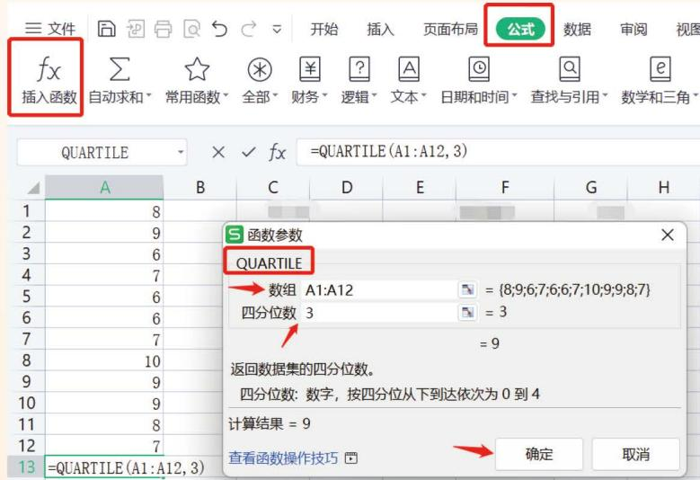

# 利用计算机软件求统计量（平均数、中位数、方差、四分位数）与绘制箱线图

## 情境引入与思考

## 知识讲解

### 北师大版初中数学·八年级上册

利用计算机软件，可以方便地求出一组数据的平均数、众数、方差等统计量。某软件的具体操作如下：

先输入一组数据，再用鼠标单击空白处，然后选择“公式/插入函数”，在“选择函数”一栏中勾选相应函数即可。其中 AVERAGE 表示平均数，MODE 表示众数，MEDIAN 表示中位数，VARA 表示方差，STDEVP 表示标准差，DEVSQ 表示离差平方和。

得到四分位数的过程如下：

在 “插入函数” 中选择 “QUARTILE” 函数，单击 “确定”，弹出对话框（如图 6-12）。在 “数组” 中选择需要寻找四分位数的数据或填写数据的首末单元格标号（中间用 “:” 隔开）；接着，在 “四分位数” 中输入 1，单击 “确定”，就成功求出 $m_{25}$ 啦！类似地，输入 2 可以求出 $m_{50}$ ，输入 3 可以求出 $m_{75}$ 。

图6-12

利用计算机软件还可以很方便地画出一组或多组数据的箱线图。有兴趣的同学可以自己探索哟！

## 本节例题与练习

- [6.2.3 随堂练习 第1题](../%E4%B9%A0%E9%A2%98/Q070000002704.md)
- [6.2.3 随堂练习 第2题](../%E4%B9%A0%E9%A2%98/Q070000002705.md)

## 所属组织

- [6.2.3 箱线图及其应用](../%E7%9F%A5%E8%AF%86%E4%B8%B2%E8%81%94/%E5%8C%97%E5%B8%88%E5%A4%A7-%E5%85%AB%E5%B9%B4%E7%BA%A7%E4%B8%8A%E5%86%8C/%E7%AC%AC%E5%85%AD%E7%AB%A0%20%E6%95%B0%E6%8D%AE%E7%9A%84%E5%88%86%E6%9E%90/2%20%E4%B8%AD%E4%BD%8D%E6%95%B0%E4%B8%8E%E7%AE%B1%E7%BA%BF%E5%9B%BE/6.2.3%20%E7%AE%B1%E7%BA%BF%E5%9B%BE%E5%8F%8A%E5%85%B6%E5%BA%94%E7%94%A8.md)

## 相关练习组织（范围关联）

- [6.2.3 箱线图及其应用](../%E9%A2%98%E5%9E%8B/%E6%8C%89%E7%AB%A0%E8%8A%82%E5%88%86%E7%B1%BB/%E5%8C%97%E5%B8%88%E5%A4%A7-%E5%85%AB%E5%B9%B4%E7%BA%A7%E4%B8%8A%E5%86%8C/%E7%AC%AC%E5%85%AD%E7%AB%A0%20%E6%95%B0%E6%8D%AE%E7%9A%84%E5%88%86%E6%9E%90/%E4%B8%AD%E4%BD%8D%E6%95%B0%E4%B8%8E%E7%AE%B1%E7%BA%BF%E5%9B%BE.md)
