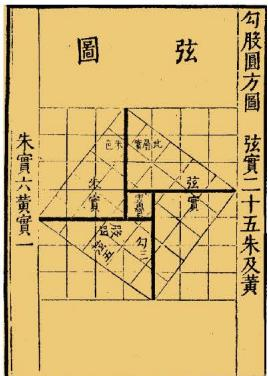

# 勾股定理的拼图验证与赵爽弦图

## 北师大版初中数学·八年级上册

勾股定理在我国有着悠久的历史。汉末三国初数学家、天文学家赵爽（3世纪初）在给《周髀》作注时，给出了相对完整的表述：“勾、股各自乘，并之为弦实。开方除之，即弦。”他利用“勾股圆方图”直观地论证了勾股定理。后人通常把图1-7称为“赵爽弦图”，2002年国际数学家大会会标的主要图案（如图1-8）就取材于此图。

图1-7

图1-8
