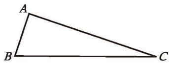

# 勾股定理的逆定理及其证明

## 北师大版初中数学·八年级下册

已知：如图 1-24（1），在 $\triangle ABC$ 中， $AB^{2} + AC^{2} = BC^{2}$ 。

求证： $\triangle ABC$ 是直角三角形。

分析：要证明 $\triangle ABC$ 是直角三角形，一般需要证明有一个角是直角。这里的已知条件是边的关系，由此你能想到什么？借助边的关系，你能构造一个直角三角形，使它与 $\triangle ABC$ 全等吗？

(1)

图1-24

证明：如图 1-24（2），作 Rt△A'B'C'，使

$$
\angle A ^ {\prime} = 90 ^ {\circ}, A ^ {\prime} B ^ {\prime} = A B, A ^ {\prime} C ^ {\prime} = A C,
$$

则 $A'B'^2 + A'C'^2 = B'C'^2$ （勾股定理）。

$$
\because A B ^ {2} + A C ^ {2} = B C ^ {2},
$$

$$
\therefore B C ^ {2} = B ^ {\prime} C ^ {\prime 2} 。
$$

$$
\therefore B C = B ^ {\prime} C ^ {\prime} 。
$$

$$
\therefore \quad \triangle A B C \cong \triangle A ^ {\prime} B ^ {\prime} C ^ {\prime} (\text { S   S   S }) 。
$$

$\therefore \angle A = \angle {A}^{\prime } = {90}^{ \circ  }$ (全等三角形的对应角相等)。

因此， $\triangle ABC$ 是直角三角形。

定理 如果三角形两条边的平方和等于第三条边的平方，那么这个三角形是直角三角形。
