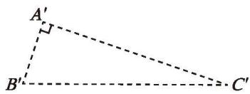

# 勾股定理的逆定理及其证明

## 情境引入与思考

## 知识讲解

### 北师大版初中数学·八年级下册

已知：如图 1-24（1），在 $\triangle ABC$ 中， $AB^{2} + AC^{2} = BC^{2}$ 。

求证： $\triangle ABC$ 是直角三角形。

分析：要证明 $\triangle ABC$ 是直角三角形，一般需要证明有一个角是直角。这里的已知条件是边的关系，由此你能想到什么？借助边的关系，你能构造一个直角三角形，使它与 $\triangle ABC$ 全等吗？

(1)

图1-24

证明：如图 1-24（2），作 Rt△A'B'C'，使

$$
\angle A ^ {\prime} = 90 ^ {\circ}, A ^ {\prime} B ^ {\prime} = A B, A ^ {\prime} C ^ {\prime} = A C,
$$

则 $A'B'^2 + A'C'^2 = B'C'^2$ （勾股定理）。

$$
\because A B ^ {2} + A C ^ {2} = B C ^ {2},
$$

$$
\therefore B C ^ {2} = B ^ {\prime} C ^ {\prime 2} 。
$$

$$
\therefore B C = B ^ {\prime} C ^ {\prime} 。
$$

$$
\therefore \quad \triangle A B C \cong \triangle A ^ {\prime} B ^ {\prime} C ^ {\prime} (\text { S   S   S }) 。
$$

$\therefore \angle A = \angle {A}^{\prime } = {90}^{ \circ  }$ (全等三角形的对应角相等)。

因此， $\triangle ABC$ 是直角三角形。

定理 如果三角形两条边的平方和等于第三条边的平方，那么这个三角形是直角三角形。

## 本节例题与练习

- [1.3 随堂练习第1题](../%E4%B9%A0%E9%A2%98/Q070000002831.md)
- [1.3 随堂练习第2题](../%E4%B9%A0%E9%A2%98/Q070000002832.md)
- [1.3 随堂练习第3题](../%E4%B9%A0%E9%A2%98/Q070000002833.md)

## 所属组织

- [直角三角形的性质、判定与互逆命题](../%E7%9F%A5%E8%AF%86%E4%B8%B2%E8%81%94/%E5%8C%97%E5%B8%88%E5%A4%A7-%E5%85%AB%E5%B9%B4%E7%BA%A7%E4%B8%8B%E5%86%8C/%E7%AC%AC%E4%B8%80%E7%AB%A0%20%E4%B8%89%E8%A7%92%E5%BD%A2%E7%9A%84%E8%AF%81%E6%98%8E%E5%8F%8A%E5%85%B6%E5%BA%94%E7%94%A8/3%20%E7%9B%B4%E8%A7%92%E4%B8%89%E8%A7%92%E5%BD%A2/%E7%9B%B4%E8%A7%92%E4%B8%89%E8%A7%92%E5%BD%A2%E7%9A%84%E6%80%A7%E8%B4%A8%E3%80%81%E5%88%A4%E5%AE%9A%E4%B8%8E%E4%BA%92%E9%80%86%E5%91%BD%E9%A2%98.md)

## 相关练习组织（范围关联）

- [直角三角形的性质、判定与互逆命题](../%E9%A2%98%E5%9E%8B/%E6%8C%89%E7%AB%A0%E8%8A%82%E5%88%86%E7%B1%BB/%E5%8C%97%E5%B8%88%E5%A4%A7-%E5%85%AB%E5%B9%B4%E7%BA%A7%E4%B8%8B%E5%86%8C/%E7%AC%AC%E4%B8%80%E7%AB%A0%20%E4%B8%89%E8%A7%92%E5%BD%A2%E7%9A%84%E8%AF%81%E6%98%8E%E5%8F%8A%E5%85%B6%E5%BA%94%E7%94%A8/%E7%9B%B4%E8%A7%92%E4%B8%89%E8%A7%92%E5%BD%A2.md)
