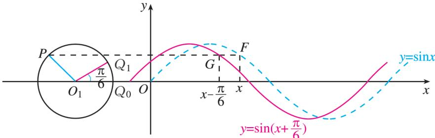
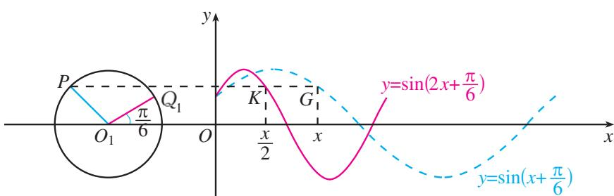

# 参数ω对正弦型函数图象的影响

## 知识讲解

如图 5.6-4，取 A=1， $\omega=1$ ，动点 M 在单位圆 $O_{1}$ 上以单位角速度按逆时针方向运动。如果动点 M 以 $Q_{0}$ 为起点（此时 $\varphi=0$ ），经过 x s 后运动到点 P，那么点 P 的纵坐标y 就等于 $\sin x$ 。以 $(x, y)$ 为坐标描点，可得正弦函数 $y = \sin x$ 的图象。

  
图5.6-4

在单位圆上拖动起点 $Q_{0}$ ，使点 $Q_{0}$ 绕点 $O_{1}$ 旋转 $\frac{\pi}{6}$ 到 $Q_{1}$ ，你发现图象有什么变化？如果使点 $Q_{0}$ 绕点 $O_{1}$ 旋转 $-\frac{\pi}{6}, \frac{\pi}{3}, -\frac{\pi}{3}$ ，或者旋转一个任意角 $\varphi$ 呢？

当起点位于 $Q_{1}$ 时， $\varphi = \frac{\pi}{6}$ ，可得函数 $y = \sin \left(x + \frac{\pi}{6}\right)$ 的图象.

下面，仍然通过数学实验来探索．如图5.6-5，取圆的半径 $A = 1$ ，为了研究方便，不妨令 $\varphi = \frac{\pi}{6}$ 当 $\omega = 1$ 时得到 $y = \sin \left(x + \frac{\pi}{6}\right)$ 的图象.

  
图5.6-5

探究

取 $\omega = 2$ ，图象有什么变化？取 $\omega = \frac{1}{2}$ 呢？取 $\omega = 3$ ， $\omega = \frac{1}{3}$ ，图象又有什么变化？当 $\omega$ 取任意正数呢？

取 $\omega = 2$ 时，得到函数 $y = \sin \left(2x + \frac{\pi}{6}\right)$ 的图象.

进一步，在单位圆上，设以 $Q_{1}$ 为起点的动点，当 $\omega = 1$ 时到达点 $P$ 的时间为 $x_{1}\mathrm{s}$ ，当 $\omega = 2$ 时到达点 $P$ 的时间为 $x_{2}\mathrm{s}$ 。因为 $\omega = 2$ 时动点的转速是 $\omega = 1$ 时的2倍，所以 $x_{2} = \frac{1}{2} x_{1}$ 。这样，设 $G(x, y)$ 是函数 $y = \sin \left(x + \frac{\pi}{6}\right)$ 图象上的一点，那么 $K\left(\frac{1}{2} x, y\right)$ 就是函数 $y = \sin \left(2x + \frac{\pi}{6}\right)$ 图象上的相应点，如图5.6-5所示。这说明，把 $y = \sin \left(x + \frac{\pi}{6}\right)$ 的图象上所有点的横坐标缩短到原来的 $\frac{1}{2}$ （纵坐标不变），就得到 $y = \sin \left(2x + \frac{\pi}{6}\right)$ 的图象。 $y = \sin \left(2x + \frac{\pi}{6}\right)$ 的周期为 $\pi$ ，是 $y = \sin \left(x + \frac{\pi}{6}\right)$ 的周期的 $\frac{1}{2}$ 。

同理，当 $\omega = \frac{1}{2}$ 时，动点的转速是 $\omega = 1$ 时的 $\frac{1}{2}$ ，以 $Q_{1}$ 为起点，到达点 $P$ 的时间是 $\omega = 1$ 时的2倍。这样，把 $y = \sin \left(x + \frac{\pi}{6}\right)$ 图象上所有点的横坐标伸长到原来的2倍（纵坐标不变），就得到 $y = \sin \left(\frac{1}{2} x + \frac{\pi}{6}\right)$ 的图象。 $y = \sin \left(\frac{1}{2} x + \frac{\pi}{6}\right)$ 的周期为 $4\pi$ ，是 $y = \sin \left(x + \frac{\pi}{6}\right)$ 的周期的2倍。

一般地，函数 $y = \sin (\omega x + \varphi)$ 的周期是 $\frac{2\pi}{\omega}$ ，把 $y = \sin (x + \varphi)$ 图象上所有点的横坐标缩短（当 $\omega > 1$ 时）或伸长（当 $0 < \omega < 1$ 时）到原来的 $\frac{1}{\omega}$ 倍（纵坐标不变），就得到 $y = \sin (\omega x + \varphi)$ 的图象.

## 本节例题与练习

- [例 1 画出函数 $y=2\sin\l](../%E4%B9%A0%E9%A2%98/Q9752165728141238118.md)
- [例 2 摩天轮是一种大型转轮状的机械建](../%E4%B9%A0%E9%A2%98/Q16312207781551141542.md)
- [练习 1](../%E4%B9%A0%E9%A2%98/Q4689965883648963200.md)
- [练习 2](../%E4%B9%A0%E9%A2%98/Q11609037927414491904.md)
- [练习 3](../%E4%B9%A0%E9%A2%98/Q1212451033772777214.md)
- [练习 4](../%E4%B9%A0%E9%A2%98/Q14011488364175347908.md)

## 所属组织

- [5.6.2 函数 $y=A\sin(\omega x+\varphi)$ 的图象](../%E7%9F%A5%E8%AF%86%E4%B8%B2%E8%81%94/%E4%BA%BA%E6%95%99A-%E5%BF%85%E4%BF%AE%E7%AC%AC%E4%B8%80%E5%86%8C/%E7%AC%AC%E4%BA%94%E7%AB%A0%20%E4%B8%89%E8%A7%92%E5%87%BD%E6%95%B0/5.6%20%E5%87%BD%E6%95%B0%20y%20%3D%20A%20sin%28%CF%89x%20%2B%20%CF%86%29/5.6.2%20%E5%87%BD%E6%95%B0%20%24y%3DA%EF%BC%8Dsin%28%EF%BC%8Domega%20x%2B%EF%BC%8Dvarphi%29%24%20%E7%9A%84%E5%9B%BE%E8%B1%A1.md)

## 相关练习组织（范围关联）

- [5.6.2 函数 $y=A\sin(\omega x+\varphi)$ 的图象](../%E9%A2%98%E5%9E%8B/%E4%BA%BA%E6%95%99A-%E5%BF%85%E4%BF%AE%E7%AC%AC%E4%B8%80%E5%86%8C/%E7%AC%AC%E4%BA%94%E7%AB%A0%20%E4%B8%89%E8%A7%92%E5%87%BD%E6%95%B0/5.6%20%E5%87%BD%E6%95%B0%20y%20%3D%20A%20sin%28%CF%89x%20%2B%20%CF%86%29/5.6.2%20%E5%87%BD%E6%95%B0%20%24y%3DA%EF%BC%8Dsin%28%EF%BC%8Domega%20x%2B%EF%BC%8Dvarphi%29%24%20%E7%9A%84%E5%9B%BE%E8%B1%A1.md)
