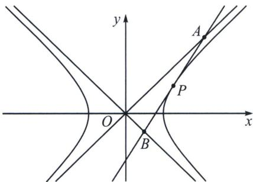
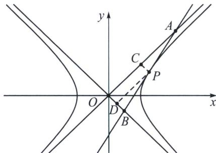

# 双曲线切线渐近三角形的性质

## 2026版高中《mst老唐说题》圆锥曲线专题（数学）

## 五、渐近切线三角形面积与向量积问题

定理：过双曲线 $\frac{x^{2}}{a^{2}}-\frac{y^{2}}{b^{2}}=1(a>0,b>0)$ 上一点 $P(x_{0},y_{0})$ ，作双曲线的切线交两渐近线于 $A(x_{1},y_{1})$ 、 $B(x_{2},y_{2})$ 两点，则称△AOB为双曲线的切线渐近三角形，双曲线的切线渐近三角形有如下性质：

(1) 点 P 处的切线方程为 $\frac{x_{0}x}{a^{2}} - \frac{y_{0}y}{b^{2}} = 1$ ，即 $k_{OP} \cdot k_{AB} = \frac{b^{2}}{a^{2}} = e^{2} - 1$ .

(2)点 P 是线段 AB 的中点，即 $\left|PA\right|=\left|PB\right|$ .

(3)①渐近三角形的面积为定值，即 $S_{\triangle AOB}=ab$ ; ② $\overrightarrow{OA}\cdot\overrightarrow{OB}=a^{2}-b^{2}$ ， $|OA|\cdot|OB|=a^{2}+b^{2}$ ;

证明：(1)和(2)都可以按照中点弦的极限原理理解，比较好记忆，关于(3)我们仅仅需要过 P 作两渐近线的平行线交于 C、D 两点，易知 $S_{AOB}=2S_{CCPD}=ab$ ，同理 $\overrightarrow{OA}\cdot\overrightarrow{OB}=2\overrightarrow{OC}\cdot\overrightarrow{2OD}=a^{2}-b^{2}$ ， $|OA|\cdot|OB|=2|OC|\cdot2|OD|=a^{2}+b^{2}$ ;

## 相关原子

- [双曲线的定义与标准方程](%E5%8F%8C%E6%9B%B2%E7%BA%BF%E7%9A%84%E5%AE%9A%E4%B9%89%E4%B8%8E%E6%A0%87%E5%87%86%E6%96%B9%E7%A8%8B.md)
- [双曲线的渐近线](%E5%8F%8C%E6%9B%B2%E7%BA%BF%E7%9A%84%E6%B8%90%E8%BF%91%E7%BA%BF.md)
- [平面向量数量积的坐标表示](%E5%B9%B3%E9%9D%A2%E5%90%91%E9%87%8F%E6%95%B0%E9%87%8F%E7%A7%AF%E7%9A%84%E5%9D%90%E6%A0%87%E8%A1%A8%E7%A4%BA.md)

## 题型训练 · 2026版高中《mst老唐说题》圆锥曲线专题（数学）

### 小题新题型与多选的综合题方法篇 / 第二节 坐标旋转与曲线转换

> [!example]- 五、渐近切线三角形面积与向量积问题
> 
