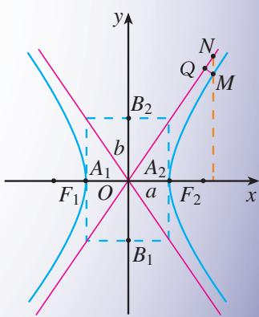

# 双曲线渐近线方程的证明

## 高中选择性必修 第一册·人教A版数学

前面我们利用信息技术，直观地得到了直线 $y = \pm \frac{b}{a} x$ 是双曲线 $\frac{x^2}{a^2} - \frac{y^2}{b^2} = 1$ 的渐近线，下面我们给出证明.

如图1，在第一象限内，双曲线 $\frac{x^2}{a^2} -\frac{y^2}{b^2} = 1(a > 0,b > 0)$ 的方程可写为 $y = \frac{b}{a}\sqrt{x^2 - a^2}$ （ $x > a$ ）．设 $M(x,y)$ 是其图象上的点， $N(x,Y)$ 是直线 $y =$

$\frac{b}{a} x$ 上的点，且与 $M(x,y)$ 有相同的横坐标，则 $Y = \frac{b}{a} x$

因为 $y = \frac{b}{a}\sqrt{x^2 - a^2} = \frac{b}{a} x\sqrt{1 - \left(\frac{a}{x}\right)^2} < \frac{b}{a} x = Y,$ 所以 $\vert MN\vert = Y - y = \frac{b}{a}(x - \sqrt{x^2 - a^2})$ $= \frac{b}{a}\cdot \frac{(x - \sqrt{x^2 - a^2})(x + \sqrt{x^2 - a^2})}{x + \sqrt{x^2 - a^2}}$

  
图1

$$
= \frac {a b}{x + \sqrt {x ^ {2} - a ^ {2}}}.
$$

设 $|MQ|$ 是点 $M$ 到直线 $y = \frac{b}{a} x$ 的距离，则 $|MQ| < |MN|$ .

当 $x$ 逐渐增大时， $|MN|$ 逐渐减小， $x$ 无限增大时， $|MN|$ 无限接近于0， $|MQ|$ 也无限接近于0。也就是说，双曲线在第一象限向右上方延伸时，是从射线 $ON$ （ $O$ 为原点）的下方逐渐接近于射线 $ON$ ，但与射线 $ON$ 永远不相交。

根据双曲线的对称性，在其他象限内，也有类似的结论.

另外，我们也可直接计算 $|MQ|$ ，证明当 $x$ 无限增大时， $|MQ|$ 无限接近于0.

## 所属组织

- [探究与发现 为什么 $y = \pm \frac{b}{a} x$ 是双曲线 $\frac{x^2}{a^2} - \frac{y^2}{b^2} = 1$ 的渐近线](../%E7%9F%A5%E8%AF%86%E4%B8%B2%E8%81%94/%E4%BA%BA%E6%95%99A-%E9%80%89%E6%8B%A9%E6%80%A7%E5%BF%85%E4%BF%AE%E7%AC%AC%E4%B8%80%E5%86%8C/%E7%AC%AC%E4%B8%89%E7%AB%A0%20%E5%9C%86%E9%94%A5%E6%9B%B2%E7%BA%BF%E7%9A%84%E6%96%B9%E7%A8%8B/%E6%8E%A2%E7%A9%B6%E4%B8%8E%E5%8F%91%E7%8E%B0%20%E4%B8%BA%E4%BB%80%E4%B9%88%20%24y%20%3D%20%EF%BC%8Dpm%20%EF%BC%8Dfrac%7Bb%7D%7Ba%7D%20x%24%20%E6%98%AF%E5%8F%8C%E6%9B%B2%E7%BA%BF%20%24%EF%BC%8Dfrac%7Bx%5E2%7D%7Ba%5E2%7D%20-%20%EF%BC%8Dfrac%7By%5E2%7D%7Bb%5E2%7D%20%3D%201%24%20%E7%9A%84%E6%B8%90%E8%BF%91%E7%BA%BF.md)

## 相关练习组织（范围关联）

- [第三章 圆锥曲线的方程](../%E9%A2%98%E5%9E%8B/%E6%8C%89%E7%AB%A0%E8%8A%82%E5%88%86%E7%B1%BB/%E4%BA%BA%E6%95%99A-%E9%80%89%E6%8B%A9%E6%80%A7%E5%BF%85%E4%BF%AE%E7%AC%AC%E4%B8%80%E5%86%8C/%E7%AC%AC%E4%B8%89%E7%AB%A0%20%E5%9C%86%E9%94%A5%E6%9B%B2%E7%BA%BF%E7%9A%84%E6%96%B9%E7%A8%8B/%E7%AC%AC%E4%B8%89%E7%AB%A0%20%E5%9C%86%E9%94%A5%E6%9B%B2%E7%BA%BF%E7%9A%84%E6%96%B9%E7%A8%8B.md)
