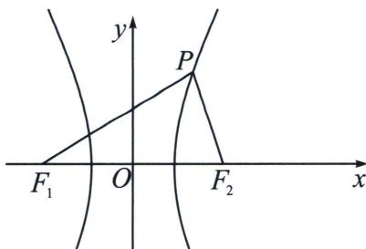
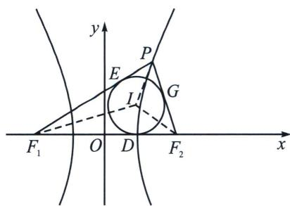

# 双曲线焦点三角形半角与离心率

## 2026版高中《mst老唐说题》圆锥曲线专题（数学）

## 四、双曲线焦点三角形两底角半角与离心率转化

已知点 $P$ 是双曲线 $\frac{x^2}{a^2} -\frac{y^2}{b^2} = 1(a > 0,b > 0)$ 右支上除顶点外的一点， $F_{1}$ 、 $F_{2}$ 分别是双曲线的左、右焦点， $\angle PF_1F_2 = \alpha$ ， $\angle PF_2F_1 = \beta$ ，双曲线的离心率为 $e$ ，则 $\frac{\tan\frac{\alpha}{2}}{\tan\frac{\beta}{2}} = \frac{e - 1}{e + 1}$

证明： $e = \frac{c}{a} = \frac{2c}{2a} = \frac{|F_1F_2|}{|PF_1| - |PF_2|} = \frac{\sin(\alpha + \beta)}{\sin\beta - \sin\alpha} = \frac{\sin 2\left(\frac{\alpha + \beta}{2}\right)}{\sin\left(\frac{\alpha + \beta}{2} - \frac{\alpha - \beta}{2}\right) - \sin\left(\frac{\alpha + \beta}{2} + \frac{\alpha - \beta}{2}\right)} = -\frac{\sin\frac{\alpha + \beta}{2}}{\sin\frac{\alpha - \beta}{2}} =$ $\frac{\tan\frac{\alpha}{2} + \tan\frac{\beta}{2}}{-\tan\frac{\alpha}{2} + \tan\frac{\beta}{2}},$ 故 $\frac{\tan\frac{\alpha}{2}}{\tan\frac{\beta}{2}} = \frac{e - 1}{e + 1};$

注意 本结论涉及双曲线的焦点三角形内心定理，知识点纵横交错形成为了命题的高密集区域.

双曲线的内心轨迹

已知双曲线 $\frac{x^2}{a^2} -\frac{y^2}{b^2} = 1$ ，则焦点三角形 $PF_{1}F_{2}$ 的内心 $I$ 的轨迹是： $x = \pm a$ ，和长轴的两个顶点相切.

证明：如上右图所示，以点 $P$ 在右支上为例，设内切圆 $I$ 和焦点三角形 $PF_{1}F_{2}$ 的三边分别切于点 $D$ 、 $E$ 、 $G$ ，则 $2a = |PF_{1}| - |PF_{2}| = |EF_{1}| - |GF_{2}| = |DF_{1}| - |DF_{2}|$ ，又 $|DF_{1}| + |DF_{2}| = 2c$ ，故 $\left\{ \begin{array}{l} |DF_{1}| = a + c \\ |DF_{2}| = c - a \end{array} \right.$ ，

所以 $|OD| = a$ ，点 $D$ 恰好和双曲线的端点重合，圆心 $I$ 在直线 $x = a$ 上．我们同样可以证明： $\frac{\tan\frac{\alpha}{2}}{\tan\frac{\beta}{2}} =$

$$
\frac {\frac {r}{| F _ {1} D |}}{\frac {r}{| F _ {2} D |}} = \frac {| F _ {2} D |}{| F _ {1} D |} = \frac {c - a}{c + a} = \frac {e - 1}{e + 1}.
$$

对比椭圆，类比焦点三角形面积公式，我们可以记忆为椭圆乘 $\tan \frac{\alpha}{2} \cdot \tan \frac{\beta}{2} = \frac{1 - e}{1 + e}$ ，双曲线除 $\frac{\tan \frac{\alpha}{2}}{\tan \frac{\beta}{2}} = \frac{e - 1}{e + 1}$ .

## 相关原子

- [双曲线的定义与标准方程](%E5%8F%8C%E6%9B%B2%E7%BA%BF%E7%9A%84%E5%AE%9A%E4%B9%89%E4%B8%8E%E6%A0%87%E5%87%86%E6%96%B9%E7%A8%8B.md)
- [双曲线的离心率](%E5%8F%8C%E6%9B%B2%E7%BA%BF%E7%9A%84%E7%A6%BB%E5%BF%83%E7%8E%87.md)

## 所属组织

- [四、双曲线焦点三角形两底角半角与离心率转化](../%E7%9F%A5%E8%AF%86%E4%B8%B2%E8%81%94/mst%E8%80%81%E5%94%90%E8%AF%B4%E9%A2%98-%E5%9C%86%E9%94%A5%E6%9B%B2%E7%BA%BF-2026/%E4%B8%8A%E5%86%8C/%E7%AC%AC03%E7%AB%A0_%E5%87%A0%E4%BD%95%E8%A7%86%E8%A7%92%E4%B8%8B%E7%9A%84%E7%84%A6%E7%82%B9%E4%B8%89%E8%A7%92%E5%BD%A2/%E7%AC%AC%E4%B8%80%E8%8A%82_%E8%A7%92%E5%BA%A6%E8%AF%AD%E8%A8%80%E4%B8%8E%E5%9D%90%E6%A0%87%E8%AF%AD%E8%A8%80%E4%B8%8B%E7%9A%84%E7%84%A6%E7%82%B9%E4%B8%89%E8%A7%92%E5%BD%A2/%E5%9B%9B_%E5%8F%8C%E6%9B%B2%E7%BA%BF%E7%84%A6%E7%82%B9%E4%B8%89%E8%A7%92%E5%BD%A2%E4%B8%A4%E5%BA%95%E8%A7%92%E5%8D%8A%E8%A7%92%E4%B8%8E%E7%A6%BB%E5%BF%83%E7%8E%87%E8%BD%AC%E5%8C%96/%E5%9B%9B_%E5%8F%8C%E6%9B%B2%E7%BA%BF%E7%84%A6%E7%82%B9%E4%B8%89%E8%A7%92%E5%BD%A2%E4%B8%A4%E5%BA%95%E8%A7%92%E5%8D%8A%E8%A7%92%E4%B8%8E%E7%A6%BB%E5%BF%83%E7%8E%87%E8%BD%AC%E5%8C%96.md)

## 题型训练 · 2026版高中《mst老唐说题》圆锥曲线专题（数学）

### 几何视角下的焦点三角形 / 第一节 角度语言与坐标语言下的焦点三角形

> [!example]- 四、双曲线焦点三角形两底角半角与离心率转化
> 
