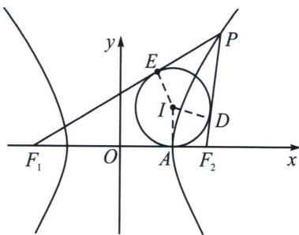

# 双曲线焦点三角形的内心轨迹

## 2026版高中《mst老唐说题》圆锥曲线专题（数学）

## 三、双曲线焦点三角形内心轨迹与双切圆

1. 内心轨迹方程

已知双曲线 $\frac{x^2}{a^2} -\frac{y^2}{b^2} = 1(a > 0,b > 0)$ ，则焦点三角形 $PF_{1}F_{2}$ 的内心 $I$ 的轨迹是： $x = \pm a$ ，和实轴的两个顶点相切.

证明：如图所示，以点 P 在右支上为例，设内切圆 I 和焦点三角形 $PF_{1}F_{2}$ 的三边分别切于点 A、D、E，则 $\left|OF_{1}\right| + \left|OA\right| = \left|F_{1}A\right| = \frac{\left|F_{1}P\right| + \left|F_{1}F_{2}\right| - \left|PF_{2}\right|}{2} = a + c$ ，故 $\left|OA\right| = a$ ，点 A 恰好和双曲线的顶点重合，则圆心 I 在直线 x = a 上.

注意 由于 $PI$ 位于点 $P(x_0, y_0)$ 处切线方程 $\frac{xx_0}{a^2} - \frac{yy_0}{b^2} = 1$ ，不妨令 $\left\{ \begin{array}{l} x_0 = \frac{a}{\cos \theta}, \\ y_0 = b \tan \theta \end{array} \right.$ ，即 $\frac{x}{a \cos \theta} - \frac{y \tan \theta}{b} = 1$ ，当 $x = a$ 时， $y = b \tan \frac{\theta}{2} \in (-b, b)$ ，所以内切圆半径 $r < b$ .

## 相关原子

- [双曲线的定义与标准方程](%E5%8F%8C%E6%9B%B2%E7%BA%BF%E7%9A%84%E5%AE%9A%E4%B9%89%E4%B8%8E%E6%A0%87%E5%87%86%E6%96%B9%E7%A8%8B.md)

## 所属组织

- [三、双曲线焦点三角形内心轨迹与双切圆](../%E7%9F%A5%E8%AF%86%E4%B8%B2%E8%81%94/mst%E8%80%81%E5%94%90%E8%AF%B4%E9%A2%98-%E5%9C%86%E9%94%A5%E6%9B%B2%E7%BA%BF-2026/%E4%B8%8A%E5%86%8C/%E7%AC%AC03%E7%AB%A0_%E5%87%A0%E4%BD%95%E8%A7%86%E8%A7%92%E4%B8%8B%E7%9A%84%E7%84%A6%E7%82%B9%E4%B8%89%E8%A7%92%E5%BD%A2/%E7%AC%AC%E4%B8%89%E8%8A%82_%E4%B8%89%E8%A7%92%E5%BD%A2%E5%9B%9B%E5%BF%83%E6%80%A7%E8%B4%A8%E7%9A%84%E5%BA%94%E7%94%A8/%E4%B8%89_%E5%8F%8C%E6%9B%B2%E7%BA%BF%E7%84%A6%E7%82%B9%E4%B8%89%E8%A7%92%E5%BD%A2%E5%86%85%E5%BF%83%E8%BD%A8%E8%BF%B9%E4%B8%8E%E5%8F%8C%E5%88%87%E5%9C%86/%E4%B8%89_%E5%8F%8C%E6%9B%B2%E7%BA%BF%E7%84%A6%E7%82%B9%E4%B8%89%E8%A7%92%E5%BD%A2%E5%86%85%E5%BF%83%E8%BD%A8%E8%BF%B9%E4%B8%8E%E5%8F%8C%E5%88%87%E5%9C%86.md)

## 题型训练 · 2026版高中《mst老唐说题》圆锥曲线专题（数学）

### 几何视角下的焦点三角形 / 第三节 三角形四心性质的应用

> [!example]- 三、双曲线焦点三角形内心轨迹与双切圆
> 
