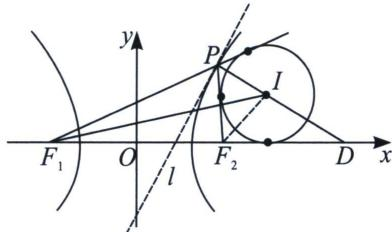

# 双曲线焦点三角形的旁心与离心率

## 2026版高中《mst老唐说题》圆锥曲线专题（数学）

## 四、双曲线焦点三角形旁心与离心率

$I$ 是 $\triangle PF_{1}F_{2}$ 的旁心， $F_{1}I$ 、 $F_{2}I$ 分别是 $\angle PF_{1}D$ 、 $\angle PF_{2}D$ 的角平分线．如图，则： $\frac{|ID|}{|IP|} = e, \frac{S_{\triangle IF_1D}}{S_{\triangle PF_1I}} = e.$ 证明：解法一（外角平分线定理+比例性质）： $\frac{S_{\triangle DIF_1}}{S_{\triangle PIF_1}} = \frac{|ID|}{|PI|} = \frac{|DF_1|}{|PF_1|} = \frac{|F_2D|}{|PF_2|} = \frac{|DF_1| - |F_2D|}{|PF_1| - |PF_2|} = \frac{2c}{2a} = e,$

解法二: (中垂线截距+光学性质) $l$ 是双曲线的切点弦(切线是切点弦极限情况), $P D$ 是切点弦 $l$ 的中垂线, 根据中垂线截距定理 $x _ { D } = \frac { c ^ { 2 } x _ { 0 } } { a ^ { 2 } }$ , 再根据角平分线定理可知 $\frac { I D } { I P } = \frac { D F _ { 1 } } { P F _ { 1 } } = \frac { \frac { c ^ { 2 } x _ { 0 } } { a ^ { 2 } } + c } { e x _ { 0 } + a } = e$

## 相关原子

- [双曲线的定义与标准方程](%E5%8F%8C%E6%9B%B2%E7%BA%BF%E7%9A%84%E5%AE%9A%E4%B9%89%E4%B8%8E%E6%A0%87%E5%87%86%E6%96%B9%E7%A8%8B.md)
- [双曲线的离心率](%E5%8F%8C%E6%9B%B2%E7%BA%BF%E7%9A%84%E7%A6%BB%E5%BF%83%E7%8E%87.md)

## 所属组织

- [四、双曲线焦点三角形旁心与离心率](../%E7%9F%A5%E8%AF%86%E4%B8%B2%E8%81%94/mst%E8%80%81%E5%94%90%E8%AF%B4%E9%A2%98-%E5%9C%86%E9%94%A5%E6%9B%B2%E7%BA%BF-2026/%E4%B8%8A%E5%86%8C/%E7%AC%AC03%E7%AB%A0_%E5%87%A0%E4%BD%95%E8%A7%86%E8%A7%92%E4%B8%8B%E7%9A%84%E7%84%A6%E7%82%B9%E4%B8%89%E8%A7%92%E5%BD%A2/%E7%AC%AC%E4%B8%89%E8%8A%82_%E4%B8%89%E8%A7%92%E5%BD%A2%E5%9B%9B%E5%BF%83%E6%80%A7%E8%B4%A8%E7%9A%84%E5%BA%94%E7%94%A8/%E5%9B%9B_%E5%8F%8C%E6%9B%B2%E7%BA%BF%E7%84%A6%E7%82%B9%E4%B8%89%E8%A7%92%E5%BD%A2%E6%97%81%E5%BF%83%E4%B8%8E%E7%A6%BB%E5%BF%83%E7%8E%87/%E5%9B%9B_%E5%8F%8C%E6%9B%B2%E7%BA%BF%E7%84%A6%E7%82%B9%E4%B8%89%E8%A7%92%E5%BD%A2%E6%97%81%E5%BF%83%E4%B8%8E%E7%A6%BB%E5%BF%83%E7%8E%87.md)

## 题型训练 · 2026版高中《mst老唐说题》圆锥曲线专题（数学）

### 几何视角下的焦点三角形 / 第三节 三角形四心性质的应用

> [!example]- 四、双曲线焦点三角形旁心与离心率
> 
